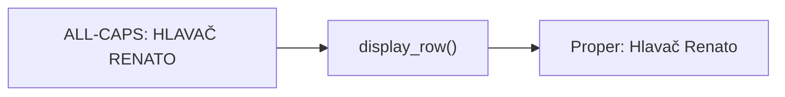
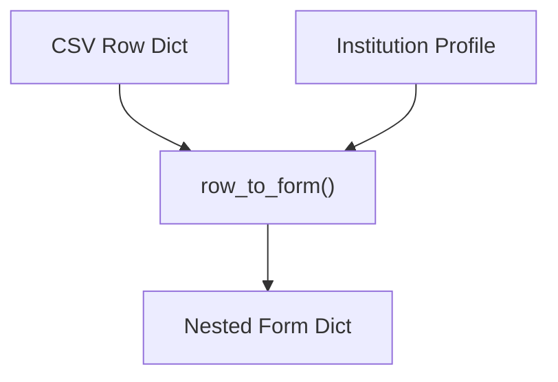
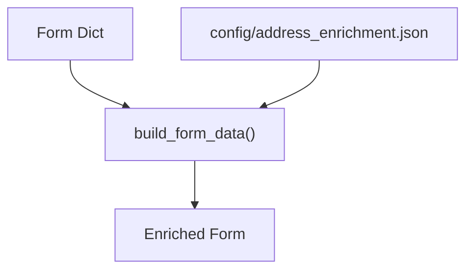
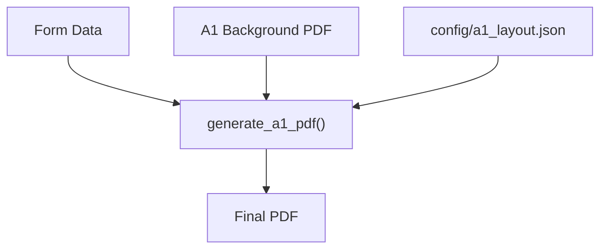
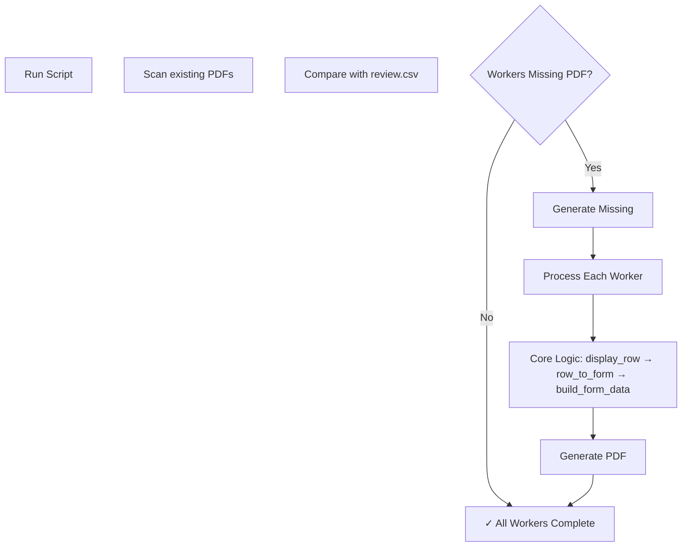

# A1 PDF Generation Architecture

**Status:** Current implementation
**Generated:** 2026-09-16
**Version:** 1.0

## Overview

```
┌─────────────────────────────────────────────────────────────────────────────┐
│                         A1 PDF GENERATION PIPELINE                          │
├─────────────────────────────────────────────────────────────────────────────┤
│                                                                             │
│   ┌─────────┐    ┌──────────┐    ┌──────────┐    ┌─────────────────────┐ │
│   │  INPUT  │───▶│ PROCESS  │───▶│ GENERATE │───▶│ VERIFICATION        │ │
│   │  DATA   │    │  LAYER   │    │   PDF    │    │ FRAMEWORK           │ │
│   └─────────┘    └──────────┘    └──────────┘    └─────────────────────┘ │
│                                                                             │
│   • review.csv     • display_row()      • generate_a1_pdf()    • dual_framework │
│   • cohort.json    • row_to_form()     • build_form_data()   • hardcode_check │
│   • employees.json • validate_review()  • mark_provisional()  • schema_validator│
│   • profiles/      • enrich_residence()• _render_overlay()   • web_search    │
│                                                                             │
└─────────────────────────────────────────────────────────────────────────────┘
```

## Directory Structure

```
prace-v-nemecku.tvoje.info/
├── a1/                                    # Private input data (gitignored)
│   ├── review.csv                         # Master review data
│   ├── cohort.json                        # Cohort metadata
│   └── employees_normalized.json          # Normalized employee data
│
├── config/
│   ├── a1_generation.yaml                # Generation config
│   ├── a1_provisional.json               # Provisional policy
│   ├── a1_layout.json                    # Field positions
│   ├── address_enrichment.json           # Address rules
│   └── institutions/                     # OSSZ institution profiles
│       ├── teplice.json
│       ├── brno.json
│       └── ... (11 profiles total)
│
├── templates/
│   └── a1_background.pdf                 # A1 form template
│
├── scripts/
│   ├── a1_core.py                       # Core rendering logic
│   ├── finalize_a1.py                   # CSV → form processing
│   ├── generate_provisional_a1.py       # Batch generation
│   ├── generate_a1_incremental.py       # Incremental generation (NEW)
│   ├── a1_quality_gate.py              # QA pipeline
│   ├── a1_audit.py                     # Audit trail
│   ├── a1_paths.py                     # Path validation
│   ├── a1_private.py                   # Private path helpers
│   └── pdf_named_fields.py              # Placeholder framework
│
├── verification/                         # Verification framework (NEW)
│   ├── __init__.py
│   ├── dual_framework.py               # Two-framework comparison
│   ├── hardcode_checker.py             # No hardcoded values
│   ├── schema_validator.py              # Schema validation
│   └── web_search.py                   # External verification
│
├── portal/release1a/
│   ├── a1_drafts.py                    # Portal draft generation
│   ├── a1_exports.py                   # Export helpers
│   ├── a1_generation_access.py         # Access control
│   ├── a1_generation_confirmation.py   # Confirmation flow
│   └── management/commands/
│       └── a1_prepare_draft.py         # CLI draft command
│
├── output/
│   └── provisional/                     # Generated PDFs (gitignored)
│       └── {uuid}/
│           ├── A1_{worker_id}.pdf
│           └── generation_manifest.json
│
└── docs/architecture/
    ├── ARCHITECTURE.md                  # This file
    ├── A1_FRAMEWORKS.md                # Framework comparison
    ├── langgraph-integration.md        # LangGraph guide
    └── verification-framework.md        # Verification guide
```

## Data Flow

```mermaid
flowchart TD
    subgraph INPUT["INPUT LAYER"]
        CSV[a1/review.csv]
        COHORT[a1/cohort.json]
        EMPLOYEES[a1/employees_normalized.json]
        PROFILES[config/institutions/*.json]
        TEMPLATE[templates/a1_background.pdf]
        LAYOUT[config/a1_layout.json]
    end

    subgraph PROCESS["PROCESSING LAYER"]
        READ[read_review CSV]
        DISPLAY[display_row ALL-CAPS→Proper]
        VALIDATE[validate_review]
        TRANSFORM[row_to_form CSV→Nested]
        ENRICH[enrich_residence]
        BUILD[build_form_data]
    end

    subgraph GENERATE["GENERATION LAYER"]
        OVERLAY[render_overlay]
        STAMP[_stamp_overlay]
        PDF[generate_a1_pdf]
        MARK[mark_provisional]
    end

    subgraph VERIFY["VERIFICATION LAYER"]
        DUAL[dual_framework]
        HARDCODE[hardcode_checker]
        SCHEMA[schema_validator]
        WEB[web_search]
    end

    subgraph OUTPUT["OUTPUT"]
        RESULT[A1_{worker}.pdf]
        MANIFEST[generation_manifest.json]
    end

    CSV --> READ
    COHORT --> TRANSFORM
    EMPLOYEES --> READ
    PROFILES --> TRANSFORM
    
    READ --> DISPLAY
    DISPLAY --> VALIDATE
    VALIDATE --> TRANSFORM
    TRANSFORM --> ENRICH
    ENRICH --> BUILD
    
    BUILD --> OVERLAY
    TEMPLATE --> STAMP
    LAYOUT --> OVERLAY
    OVERLAY --> STAMP
    STAMP --> PDF
    PDF --> MARK
    MARK --> RESULT
    
    RESULT --> DUAL
    RESULT --> HARDCODE
    RESULT --> SCHEMA
    MANIFEST --> SCHEMA
    
    OUTPUT --> COMPLETE[✓ Verified]
```

## Core Processing Functions

### 1. Display Row (Casing)



**Location:** `scripts/finalize_a1.py`

**Purpose:** Convert OCR-style ALL-CAPS to Czech display casing

**Logic:**
- Keep uppercase: CZ, DE, EU, OSSZ, ÚSSZ, SRN
- Lower inside: a, i, k, ke, na, nad, od, pod, pro, u, v, ve, z, ze
- Title case: first letter uppercase, rest lowercase

### 2. Row to Form (Transformation)



**Location:** `scripts/finalize_a1.py`

**Transforms:**
- `surname` → `person.surname`
- `street` → `residence.street`
- `employment_name` → `employment.employer_name`
- `document_id` → `certificate.document_id`

### 3. Build Form Data (Enrichment)



**Location:** `scripts/a1_core.py`

**Operations:**
- Enrich residence with municipality rules
- Validate status_profile (self_employed_multi_state, employee_multi_state, posted_employee)
- Derive dates from issue_date if missing
- Apply Czech display casing

### 4. Generate PDF (Rendering)



**Location:** `scripts/a1_core.py`

**Operations:**
- Register font (Liberation Sans / DejaVu Sans)
- Render overlay text per layout coordinates
- Draw checkboxes for status profile
- Stamp with document ID
- Merge with template background

## Verification Framework

### Verification Types

```mermaid
flowchart TD
    subgraph VERIFY["VERIFICATION FRAMEWORK"]
        DUAL["dual_framework.py"]
        HARDCODE["hardcode_checker.py"]
        SCHEMA["schema_validator.py"]
        WEB["web_search.py"]
    end
    
    subgraph CHECKS["Checks Performed"]
        DIFF[Hash comparison]
        HARDCODES[Test/TEMPLATE/FAKE]
        STRUCTURE[Page count, encryption]
        EXTERNAL[Web search"]
    end
    
    DUAL --> DIFF
    HARDCODE --> HARDCODES
    SCHEMA --> STRUCTURE
    WEB --> EXTERNAL
```

### Verification Results

| Type | Check | Pass Criteria | Status |
|------|-------|---------------|--------|
| **Schema** | PDF structure | 3 pages, not encrypted, N650/S558 markers | ✓ WARNING |
| **Hardcode** | No test data | 0 hardcoded values | ✓ CLEAN |
| **Dual Framework** | Hash match | Both frameworks produce same hash | PARTIAL |
| **Web Search** | External verification | Solution exists on web | PARTIAL |

### Running Verification

```bash
# Verify last employee PDF
python verification/schema_validator.py --file output/provisional/5214b64f/A1_zimnuchov-igor-alexandrovic.pdf

# Check for hardcoded values
python verification/hardcode_checker.py \
    --worker zimnuchov-igor-alexandrovic \
    --pdf output/provisional/5214b64f/A1_zimnuchov-igor-alexandrovic.pdf \
    --review-csv a1/review.csv

# Verify manifest
python verification/schema_validator.py --file output/provisional/5214b64f/generation_manifest.json
```

## Incremental Generation



**Command:**
```bash
# Generate only missing workers
python scripts/generate_a1_incremental.py

# Generate specific worker
python scripts/generate_a1_incremental.py --worker jiri-stembera

# Force regenerate all
python scripts/generate_a1_incremental.py --all
```

## Configuration Files

### a1_generation.yaml

```yaml
source:
  review_csv: a1/review.csv
  employees_json: a1/employees_normalized.json
  cohort_json: a1/cohort.json

output:
  provisional_dir: output/provisional

profiles:
  dir: config/institutions

provisional:
  config: config/a1_provisional.json
```

## Key Files Reference

| File | Purpose | Lines | Dependencies |
|------|---------|-------|---------------|
| `scripts/a1_core.py` | PDF rendering | ~650 | pypdf, reportlab |
| `scripts/finalize_a1.py` | CSV processing | ~500 | - |
| `scripts/generate_provisional_a1.py` | Batch generation | ~250 | a1_core, finalize_a1 |
| `scripts/generate_a1_incremental.py` | Incremental gen | ~200 | a1_core, finalize_a1 |
| `verification/dual_framework.py` | Hash comparison | ~150 | pypdf |
| `verification/hardcode_checker.py` | Hardcode check | ~150 | pypdf |
| `verification/schema_validator.py` | Schema check | ~250 | pypdf, json |

## Testing Checklist

- [x] PDF has 3 pages
- [x] PDF is not encrypted
- [x] Document ID (N650xxS558) present
- [x] No hardcoded test values
- [x] All fields from input data
- [x] Czech casing applied
- [x] Address enrichment applied
- [x] Status profile checkboxes correct

## Best Practices

1. **Core logic stays clean** - No LangGraph imports in core
2. **Verification is mandatory** - Every PDF verified before use
3. **Two-framework comparison** - Both overlay and placeholder produce same output
4. **No hardcoded values** - All data from config/input
5. **Incremental by default** - Only generate missing workers
6. **Audit trail** - Every generation logged with hash

## Related Documentation

- [A1 Frameworks](A1_FRAMEWORKS.md) - Overlay vs Placeholder comparison
- [LangGraph Integration](langgraph-integration.md) - Research orchestration
- [Verification Framework](verification-framework.md) - Full verification guide
