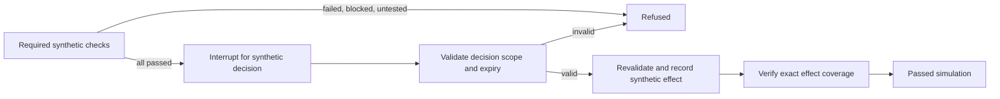

# Agent operations workflow: local synthetic experiment

Status: implemented research demonstration, not a production control plane.
Parent work: REL-03/REL-05/REL-06 and INFRA-PG-01 in the
[active delivery plan](../../plans/2026-09-14-delivery-reliability-and-jan-v1.md).
The [research design](../research/2026-09-16-devops-workflow-design.md) compares
existing controls with the proposed fleet workflow. Live observations belong in
`docs/operations/2026-09-16-agent-ops-review.md`.

The delivered demonstration uses an actual local LangGraph graph and SQLite
checkpointer. Its only effect is recording a synthetic row in another SQLite
file. No node can invoke SSH, Ansible, shell commands, HTTP, a model/provider or a
host service. Only `synthetic-app-a` and `synthetic-app-b` are accepted targets;
source revisions are visibly synthetic. Production host inventory is not input.



The versioned policy is [agent_ops_workflow.v1.json](../../config/agent_ops_workflow.v1.json),
the implementation is [research_agent_ops_workflow.py](../../scripts/research_agent_ops_workflow.py),
and the focused suite is [test_agent_ops_workflow.py](../../tests/test_agent_ops_workflow.py).
Graph inputs and node outputs are validated; required check failures stop before
the approval node. Target coverage preserves separate failures and unknowns.
The graph has a 30-transition bound and no retry/watch loop.

`SyntheticAuthority` is deliberately a process-local **test fixture**. Its
actor string and opaque decision ID are not authentication. Only the harness
issues synthetic decisions; a graph payload such as `{"approved": true}` is
rejected before checkpointing. The fixture binds decisions to run, revision,
targets, actor and expiry, and models rejection/revocation. Real operational
identity, approval storage, authorization and revocation integration remain
unimplemented. There is no live execution mode to authorize.

Approval and effect are separate nodes. Effects use a SQLite transaction with
an `(action, revision, target)` unique key and a recorded run owner. An exception
before the transaction creates no effect. After-commit failure is recovered by
reopening the graph and reconciling existing rows. A second run cannot adopt
another run's effects; a completed resume returns `already_complete`.
This atomic local ledger does not establish exactly-once remote execution.

The command-line demo closes and reopens graph/checkpointer instances, injects
an after-commit exception, reconciles both target effects and refuses a duplicate
effect. Its JSON explicitly says `process_restart: false`. The focused suite
also resumes a paused checkpoint in a **fresh Python subprocess**, issuing a new
synthetic fixture decision in that process. Crash tests simulate exceptions;
they do not reproduce an operating-system crash or power loss. Fixture decisions
do not survive a process restart after approval: a lost registry safely refuses
recovery, and a real trusted decision store remains future work.

## Run the demonstration

Canonical application dependencies and `venv` remain unchanged. The optional
experiment pins LangGraph 1.2.11, checkpoint-sqlite 3.1.1 and pytest 9.1.1,
verified against their public PyPI metadata on 2026-09-16:
[LangGraph](https://pypi.org/pypi/langgraph/1.2.11/json),
[SQLite checkpointer](https://pypi.org/pypi/langgraph-checkpoint-sqlite/3.1.1/json),
[pytest](https://pypi.org/pypi/pytest/9.1.1/json).
These are experiment pins, not a recommendation to change application versions.

Use a new owner-only directory under `runtime/portal/temporary/` and an isolated
virtual environment there. Setup downloads public packages, so that stage needs
network access; demo/test execution can run in a network namespace with no
network. No API key is needed. Use an empty allowlisted subprocess environment,
an explicit PyPI index and disabled pip configuration/caches. The [resolved version lock](../../config/agent_ops_workflow.v1.requirements.txt)
records the tested transitive versions. It is not a wheel-hash lock or proof of
cross-platform reproducibility. Retain the installation receipt privately.

A fresh setup can use this explicit, non-provider command sequence from the
repository root. Pick a new directory name; refuse an existing destination.

```bash
set -euo pipefail
umask 077
experiment_root="runtime/portal/temporary/agent-ops-$(date -u +%Y%m%dT%H%M%SZ)-$$"
test ! -e "$experiment_root" && mkdir -m 700 "$experiment_root"
python3 -m venv "$experiment_root/venv"
env -i PATH=/usr/bin:/bin LANG=C.UTF-8 PIP_CONFIG_FILE=/dev/null \
  "$experiment_root/venv/bin/python" -m pip --isolated install --no-cache-dir \
  --index-url https://pypi.org/simple \
  -r config/agent_ops_workflow.v1.requirements.txt
```

Use that interpreter for the tests/demo below. Package installation requires
network; actual graph execution can remain network-isolated. No credentials
are read by this setup.

The initial experiment environment is
`runtime/portal/temporary/agent-ops-langgraph-demo-20260916/venv/`. When present,
run these from the repository root (each basetemp must be exclusively owned and
new; pytest cleans its selected basetemp):

```bash
# Structural validation only; safe with canonical venv and no graph dependency.
venv/bin/python scripts/research_agent_ops_workflow.py --validate-contract

# Run once in the isolated experiment environment; no application DB required.
env -i PATH=/usr/bin:/bin LANG=C.UTF-8 PYTHONNOUSERSITE=1 \
  unshare -Urn runtime/portal/temporary/agent-ops-langgraph-demo-20260916/venv/bin/python \
  -m pytest tests/test_agent_ops_workflow.py -q \
  --basetemp=runtime/portal/temporary/agent-ops-langgraph-demo-20260916/pytest-first

# Creates a new private receipt/checkpoint directory automatically.
env -i PATH=/usr/bin:/bin LANG=C.UTF-8 PYTHONNOUSERSITE=1 \
  unshare -Urn runtime/portal/temporary/agent-ops-langgraph-demo-20260916/venv/bin/python \
  scripts/research_agent_ops_workflow.py --demo
```

Missing experiment dependencies cause failure, not a silent test skip.
`--validate-contract` is explicitly a schema/policy check and never counts as a
LangGraph runtime test. A machine without unprivileged network namespaces needs
an equivalently isolated execution environment; do not silently label an
unconfined run network-isolated. The initial private receipt records exact
implementation/config hashes and resolved runtime versions. Check file identity
before reusing evidence after an edit.

## Boundaries and remaining work

- Checkpoint and effect files stay under the private repository runtime, with
  0700 directories and 0600 files. Parent traversal, the shared temporary root,
  symlink/foreign paths, hardlinked SQLite files and existing demo output reuse
  are refused. This is a single-owner experiment; path checks are not a
  hardened defense against a concurrent hostile local user.
- No raw command output, real identifiers, secrets or arbitrary message payloads
  enter state. Hosted tracing is disabled; the tests use no network. SQLite
  state is not encrypted, contains only synthetic enums/opaque IDs, and follows
  existing private-artifact retention policy.
- The executable models synthetic check results; it does not execute Ansible
  checks, host health probes or application acceptance. `passed` always means
  the simulation passed. It does not grant fleet deployment or Jan acceptance.
- Restart/resume controls cover bound synthetic decisions, stale/expired/revoked
  decisions, duplicate/cross-run/changed-target effects and required-check stops.
  Concurrent workers, lock leasing across machines, real approval systems,
  graph-version migrations, backup/restore, power-loss durability and remote
  command reconciliation remain untested/unimplemented.
- Actual fleet integration requires the operational infrastructure source,
  reviewed Ansible dependency closure, target inventory and existing/new exact
  authorization. Any operator wait must show the concrete action packet and
  the missing authority. Existing authorization must be reused.

Extend existing evidence and domain services if this experiment proves useful.
Do not introduce another application audit schema, inventory authority, CI
activation or prerequisite for Jan's core-v1 delivery.
