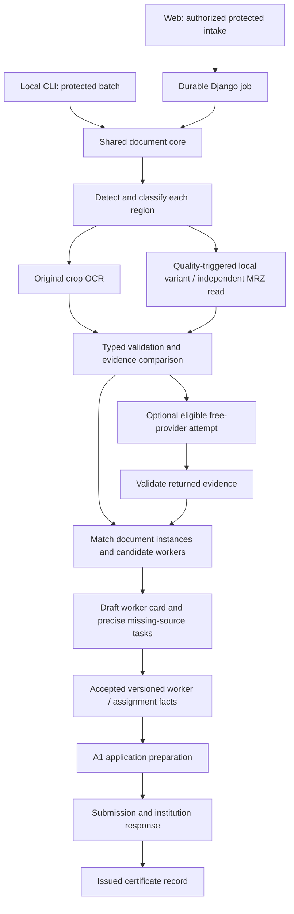

# OCR, worker records, and A1: local/web workflow investigation

Date: 2026-09-06. Scope: research and solution definition, with local aggregate diagnostics and synthetic probes. This is a completed investigation, not a production implementation or a release approval. Technical defaults below are selected to implement the user's intention; they are not questions awaiting a user decision.

## 1. Finding and resolution

The requested workflow is **document-first intake**: discover what each image contains, separate document regions and sides, read fields in their document context, reconcile evidence, associate documents with workers, and identify the precise source of anything missing. Asking the operator to diagnose a filename or choose between speculative identity explanations is premature.

The current system does not deliver this. Local A1 rendering exists, but the documented local scan adapter is absent. The web solution is a synthetic Django prototype with storage, classification, extraction, confirmation, and readiness defects. Its interfaces and database objects are useful foundations; their existence is not evidence of an operational OCR pipeline.

**Selected architecture:** one framework-independent Python document-processing core, a local file/CLI adapter, and a Django storage/job/UI adapter. Use local OCR and deterministic validation first. Keep OpenRouter and Kilo as optional, explicitly eligible, zero-cost adapters. LiteLLM may implement their transport; it must not decide identity, approval, privacy eligibility, or whether a model is free.

The workflow automatically determines document type, side, quality, candidate pairing, repeat processing, missing-source tasks, and draft worker-card content. Existing authoritative values remain versioned. Unresolved identity evidence remains unresolved rather than producing invented people or approvals.

## 2. What was checked

Inspected [AGENTS.md](../../AGENTS.md), [real-data policy](../security/real-data-rules.md), [roadmap](../../roadmap.md), [plan index](../../plans/INDEX.md), active [workers](../../plans/PLAN-WORKERS.md), [A1](../../plans/PLAN-A1.md), and [free-model](../../plans/PLAN-FREE-MODEL.md) plans, the [A1 skill](../../.agents/skills/a1-pdf-production/SKILL.md) and field policy, local scan documentation, source code, installed RapidOCR API, and official document/provider/framework sources.

The inspected branch was `feat/prace-readiness-plan-2026-08-13`. It already had unrelated modifications, including institution profiles, approval tooling, and portal views. Findings describe that working tree, not a clean commit. Those files were not changed by this investigation.

An audited local aggregate check read existing A1 inputs and compared PDF hashes without exposing employee values. Its non-content audit is in protected `evidence/ocr-workflow-analysis-2026-09-06.jsonl`. No real scans were sent to a model, no provider inference was performed, no credentials were loaded, and no real employee fields or PDF packages were modified. Public ministry specimen PDFs were inspected locally. The two disputed personal scans were **not** visually adjudicated; this report does not assert their ownership.

## 3. Actual local state supersedes the quoted counts

| Check | Observed on 2026-09-06 | Meaning |
|---|---:|---|
| Review rows / unique employee IDs | 25 / 25 | Neither the earlier 17-row nor 24-row account is current |
| Canonical `readiness_report` blockers | 25 of 25 | No current row passes this prerequisite check |
| AUTHORITATIVE activity / certificate / signatory statuses | 0 / 0 / 0 | Approval flags do not supply missing evidence |
| `validated_by_user=1` | 23 rows | Stored flag only; this investigation did not authenticate who set it |
| `identity_reviewed=YES` | 24 rows | Also not independent evidence of an actual review |
| `certificate_reviewed=YES`, `approved_for_pdf=YES` | 23 rows each | Contradicts an account of universally approved records |
| Section 4 employment columns | All seven present | Header absence is not the current problem; row completeness is separate |
| Normalized records | 25 | Count alone does not validate identity reconciliation |
| Cohort date / certificate-ID entries | 27 / 27; two additional people | Reconcile sets and eligibility, not only totals |
| Direct files in `scans/` | 0 | A moved file is not proof of successful OCR |
| Direct files in `scans/processed/` | 58; 57 recognized image extensions | No claim that all 58 are successfully processed scans |
| PDFs in `output/provisional/` | 25 | Rendered artifacts exist |
| PDFs in `output/final/pdf/` | 25 | Every PDF hash also occurs in the provisional set |

The final-directory files are therefore byte-identical provisional copies, with no current readiness evidence supporting finalization. Do not use their directory name as an issuance or approval signal. A full per-artifact provenance and visual review was outside this report; no claim is made about current preview counts or all-page visual quality.

Both modified institution profiles say `VERIFIED` while retaining placeholders: Kladno has placeholder street and code; Ústí nad Labem has a placeholder code. Setting a verification date or status does not validate their contents, nor does a verified public office contact establish who signed an individual's certificate.

## 4. Actual behavior versus required behavior

| Area and code evidence | Actual behavior | Required behavior |
|---|---|---|
| Local intake — [scan contract](../../readme-scan-to-employees.md) | Explicitly says the production scan adapter is absent | A reproducible, resumable local command producing protected proposals and provenance |
| Web upload — [services](../../portal/release1a/services.py), `upload_document` | Creates a completed OCR run and a fixed synthetic surname proposal | Persist bytes and let a real processing job determine the result |
| Web intake — same file, `process_intake_document` | Creates metadata, classifies once at page zero, attempts OCR synchronously; leaves run pending | Persist immutable bytes; enumerate pages/regions; durable job states and typed errors |
| Quarantine — `quarantine_and_validate` | Checks an allowed MIME string and a few magic bytes; no malware engine or full decode | Validate claimed versus decoded format, dimensions/page limits, safe parsing, and actual configured security checks |
| Classification — `classify_document` | PDF size chooses front/back; image page parity chooses front/back | Pixel/text/layout evidence plus country/version; unknown must remain possible |
| Extraction — `create_field_proposals_from_classification` | Passes `version.opaque_key` as image input; assumes an old tuple result API; catches exceptions silently | Read protected bytes, render PDFs locally, adapt the pinned RapidOCR output, record failure distinctly |
| Field mapping — `map_ocr_text_to_field` | Accent normalization conflicts with Czech regex labels; generic first-match dates/numbers; stores entire OCR line | Layout-aware label/value association; typed semantic fields; source coordinates and raw/normalized values |
| Document/worker model — [models](../../portal/release1a/models.py) | `Document` requires one Worker before recognition; no passport classification or document-region entity | Unassigned intake and multiple independently matched regions; document instances separate from uploads |
| Confirmation — services plus [views](../../portal/release1a/views.py), `ocr_field_review` | Creates decisions without applying a coherent authoritative revision; any POST marks document confirmed, even if nothing was accepted | One atomic validated decision/revision transition; unresolved required fields cannot become confirmed |
| Readiness — views, `worker_a1_readiness` | Counts field names from all proposals, including missing/empty/unconfirmed ones | Count accepted nonempty values from current, non-superseded evidence; validate assignment and profile separately |
| Download — `document_download` | Returns synthetic JSON, not protected document bytes | Authorized and audited delivery from protected storage |
| Worker detail | Basic identity/activity fields; no portrait relation | Draft/accepted data, document coverage, source crops, conflicts, task status, optional protected portrait |
| A1 preparation — services, `prepare_a1` | Uses the synthetic architecture proof and a hash; assigns `is_stale` although `A1Case` has no such persisted field | Immutable input snapshot and actual artifacts; persist staleness and reject reuse after source change |
| Provider discovery — [script](../../scripts/list_vision_models.py) | Standalone tests and printed fallback template; not a reusable OCR runner | Separate metadata discovery, synthetic capability evaluation, and policy-gated execution |

Further service-boundary gaps: intake/confirmation check membership rather than the specific capability; they do not independently enforce every related object's organization. Views sometimes scope objects, but background/CLI reuse must not depend on a particular caller. `OcrRun.idempotency_key` lacks a uniqueness constraint; querying a key built from newly created IDs does not provide retry deduplication. `FieldDecision` is described as immutable but has no immutable-save or one-decision constraint. These require integration and concurrency tests.

## 5. Reproduced defects and test results

Read-only AST-isolated probes executed the existing pure functions using synthetic input, without starting Django, importing the discovery script, or opening private scans:

| Synthetic probe | Observed result |
|---|---|
| Standard JPEG prefix `FF D8 FF E0` | Rejected: compares four input bytes with a three-byte JPEG signature |
| PNG signature | Accepted by header check; this is not proof that the image decodes |
| `%PDF...` bytes declared `image/png` | Accepted: signature is not matched to the claimed MIME type |
| `PŘÍJMENÍ: TESTOVÝ` | No field match after normalization removes accents from input but not the regex |
| `PLATNOST DO: 14.03.2030` | Mapped to `dob` before expiry matching is attempted |
| `RODNÉ ČÍSLO: 000000/0000` | Mapped to `residence_house_number` |
| Identical image metadata, page index 0 versus 1 | Classified as OP front versus back without reading image content |

Installed packages: RapidOCR 3.9.2 and ONNX Runtime 1.29.0; LiteLLM is absent. Installed RapidOCR accepts bytes/arrays/paths and returns `RapidOCROutput` with `boxes`, `txts`, and `scores`; the portal expects `result, elapsed`. This is a concrete API mismatch, not evidence that RapidOCR cannot run on this host. No OCR model initialization, downloads, or accuracy benchmark occurred. The current [RapidOCR example](https://github.com/RapidAI/RapidOCR/blob/main/assets/RapidOCRDemo.ipynb), also queried through Context7, corroborates the result-object interface.

Executed:

```text
venv/bin/python -m pytest tests/test_finalize_a1.py tests/test_free_model_eval_preflight.py -q
15 passed, 1 failed
```

Failure: `FinalizationTests.test_verified_project_profiles_contain_no_placeholder_values`, at `tests/test_finalize_a1.py:307`, detects the placeholder institution code in the VERIFIED Ústí profile. A separate structural check also detects both Kladno placeholder fields. The suite stops within that test at its first offending profile. These are focused checks, not a portal acceptance or full-suite result; earlier “74/74” and “QA passed” statements cannot establish the current workflow's correctness.

## 6. What OP, ZP/EHIC, and passport images actually contain

**A file page is not a document side.** One photo can contain OP front, OP back, a health card, or several people's documents. Conversely, sides may arrive in unrelated files or reversed order. Classify each detected region; derive “OP + ZP + passport” as an inventory of regions, not a single mutually exclusive document type.

The ministry's [2012/2014 specimens](https://mv.gov.cz/soubor/obcanske-prukazy-se-strojove-citelnymi-udaji.aspx) and [August 2021 specimen](https://mv.gov.cz/soubor/obcanske-prukazy-se-strojove-citelnymi-udaji-od-viii-2021.aspx) were downloaded from their public URLs and visually inspected locally. The 2021 URL failed in the browsing tool but succeeded via local HTTPS retrieval. PRADO separately lists [2021 CZE-BO-04003](https://www.consilium.europa.eu/prado/en/CZE-BO-04003/index.html) and [2023 CZE-BO-04004](https://www.consilium.europa.eu/prado/en/CZE-BO-04004/index.html). Version recognition is therefore necessary; a single permanent coordinate map is insufficient. The 2023 layout was not visually calibrated in this investigation.

| Document region | Expected readable information | Required interpretation |
|---|---|---|
| Czech OP front, inspected 2012/2021 examples | Holder surname/given names, portrait, document number, DOB, sex, birthplace, citizenship, issue date, expiry, holder signature; 2021 also has a separate access-number field | Birth, issue, and expiry dates are separate. Access number is not document number. Signature is not an A1 signatory |
| Czech OP back, inspected examples | Permanent-address text, personal number, issuing authority, optional/version-dependent entries, and three-line MRZ | Authority/address text is not the holder's surname. Postal code need not be printed. Optional fields are not universal requirements |
| OP back MRZ, TD1 | Encoded document number, birth date, sex, expiry, nationality, surname and given names, with defined check digits | Provides cross-side evidence; does not encode the address or the card's issue date |
| EHIC data-bearing side | Numbered fields 3 surname, 4 given names, 5 DOB, 6 personal identification number, 7 insurance institution, 8 card number, 9 expiry; issuing-state marking | Keep fields 6, 7, and 8 distinct. Recognize the EHIC face even when physically printed on a national card's reverse |
| Other ZP side / national variant | Issuer-specific information; may add no worker fields | Do not demand a second image solely because an OP has two useful sides. Non-EHIC variants need their own schema |
| Passport biographical page | Holder identity, portrait, document details and TD3 MRZ; national visual fields vary | Model a passport page, not “OP front/back.” A two-line MRZ has its own parser. Residence/insurance/employer data require another source |

MRZ interpretations follow [ICAO Doc 9303 Part 5, TD1](https://www.icao.int/sites/default/files/publications/DocSeries/9303_p5_cons_en.pdf) and [Part 4, passports](https://www.icao.int/sites/default/files/publications/DocSeries/9303_p4_cons_en.pdf). Validate field positions, checksums, and dates; checksum success detects some reading errors but does not authenticate a document or prove ownership. Preserve century ambiguity in MRZ dates until visual DOB and document context resolve it.

EHIC mapping and the ability to place EHIC on either card side follow [EU Decision S2, Annex I](https://eur-lex.europa.eu/legal-content/EN/ALL/?uri=CELEX:32010D0424(09)). [VZP's card guidance](https://www.vzp.cz/pojistenci/informace-a-zivotni-situace/prukaz-pojistence) also distinguishes EHIC from other national cards. Do not assume an insurance personal number is always a Czech birth number, or that a printed unexpired card proves current coverage. The application should store identifier type and issuer rather than coerce different identifiers into one string field.

## 7. Correct identity matching and completeness

For the disputed pair, neither the filename nor the quoted OCR narrative establishes whose document it is. The workflow must first locate the disputed text and determine whether it belongs to a holder-name field, address, authority, MRZ, another card, or an OCR error. There is no justified conclusion here that it belongs to a different worker. There is likewise no justified automatic merge.

The previous explanation contains a demonstrable reasoning error: the intervals 2021–2031 and 2022–2032 overlap. Differing printed validity periods alone establish neither same-person nor different-person status. An impossible calendar date invalidates that reading; it does not make the other side automatically authoritative. An implausibly recent “birth date” should trigger field-location and date-semantic checks before a new worker is created.

Selected automatic sequence:

1. Detect all card/page regions; retain immutable source hash, page index, polygon and orientation. Filename hints have no identity authority.
2. Identify country, document family, version and side from visual features, labels and MRZ structure. Return `unknown` or `unsupported_variant` when evidence is insufficient.
3. Read visual fields and MRZ independently; map labels and coordinates to document-specific meanings before comparing values.
4. Match sides of the **same document instance** using document number and corroborating DOB/name/expiry evidence. Distinguish this from linking different documents to the same person. Different document numbers can be renewed cards belonging to one person.
5. Match document instances to an existing worker within the organization using typed strong identifiers and corroborating identity evidence. Same given name, filename prefix or visual similarity alone is insufficient. Do not use face recognition.
6. Automatically attach unambiguous evidence to the draft worker card; leave conflicting candidates in the intake workspace. Preserve all candidates and source versions. Do not delete an “orphan” or create a second authoritative worker merely to unblock rendering.
7. Retry uncertain regions locally, compare independent evidence, then produce a precise exception only for ambiguity that remains. State the conflicting fields, source regions, attempted checks, and what evidence would resolve it.

Track three independent completeness measures: **document coverage** (which relevant sides/pages exist), **field sufficiency** (needed fields readable and supported), and **workflow readiness** (worker/assignment/application/certificate requirements). One missing OP back may be acceptable for identity identification but leave residence incomplete. A readable passport can satisfy identity needs without an invented requirement to scan every passport page. An informational health-card back need not block insurance extraction. None of those facts supplies employment or certificate evidence.

## 8. Where missing information should come from

| Missing item | Automatic routing / source | Boundary |
|---|---|---|
| Holder identity or an unreadable number | Original relevant region, alternate side/MRZ, another already supplied identity document | Do not search the public web for the worker's identity |
| Residence street/number/town | OP residence region or separately supported current residence declaration | Card's registered address is not automatically current contact address |
| Address normalization, postal code, district | Unique address match against locally cached official address data; preserve lookup evidence | Address existence does not prove that the worker lives there |
| Insurance institution | EHIC field 7 and official insurer reference data | Health insurer is not automatically the competent A1/social-security institution |
| Current insurance entitlement | Authorized insurer evidence/integration | Printed card expiry is insufficient for a live entitlement claim |
| Employer/OSVČ registered business details | Known entity identifier and official registry lookup | Registry presence does not prove an employment relationship or actual assignment |
| Employment status, work location, activity and dates | Assignment, contract, employer/worker declaration, and relevant supporting evidence | Not supplied by OP/ZP/passport; not all such facts come from OSSZ |
| Requested A1 period | Application/assignment facts | Separate from the period ultimately certified |
| Issued A1 number, certified period, issuance and institution authentication | Actual competent-institution response/certificate | Never substitute an OP number, date of scanning, website contact, or generated sequence |

[ČÚZK describes RÚIAN's public access](https://cuzk.gov.cz/Uvod/Produkty-a-sluzby/RUIAN/RUIAN-%281%29.aspx); use its address reference data without transmitting worker identity to a search engine. [MF describes ARES](https://mf.gov.cz/cs/ministerstvo/informacni-systemy/ares) as a source of public economic-subject information. Both are enrichment sources with limited meaning, not identity or employment adjudicators.

[ČSSZ's application service](https://eportal.cssz.cz/web/portal/-/sluzby/zadost-o-urceni-pouzitelnych-pravnich-predpisu-pro-zamestnance-pojistenec) requests determination and issuance; it does not describe locally filling a certificate template as issuance. Select employee, self-employed, or mixed activity from supported operational facts. The provisional generator currently supports only `self_employed_multi_state`; it cannot represent every worker's status by default.

## 9. One clean core, two adapters

Proposed module boundary: `src/document_intake/` for pure schemas, segmentation, classification, extraction adapters, matching, validation and completeness. This path is a design target, not an implemented package. Reuse the existing A1 renderer through an explicit export boundary rather than putting OCR logic into A1 scripts.



| Responsibility | Local Python solution | Web solution |
|---|---|---|
| Persistence | Opaque protected originals/derivatives; atomic manifest and append-only audit under allowed private directories | Same content contracts through protected storage; organization-scoped Django records |
| Scheduling | Bounded worker pool and resumable batch; one coordinator writes the result manifest | Existing Django-Q2 dependency; jobs receive opaque IDs and fetch authorized bytes |
| Workflow | Batch report and protected draft records; no interactive question for each crop | Intake progress, worker detail card, source viewer and exception queue |
| Concurrency | Hash/policy-version idempotency key, atomic output replacement | Database uniqueness, job lease, short transactions, version checks and atomic acceptance |
| Export | Explicit accepted snapshot to canonical A1 inputs | Same exporter/renderer contract, generated artifacts and protected previews |

Retain `DocumentVersion`, `OcrRun`, `FieldProposal`, `FieldDecision`, `WorkerIdentityRevision` and `ReviewTask`; repair their invariants. Add a region/derivative representation and document-instance/worker association so a mixed upload is not forced onto one worker. Separate field namespaces such as `identity_document.number`, `health_card.number`, `person.birth_date`, and `a1_certificate.number`; today's overloaded `document_id` must not carry all of them.

Each field observation needs source/version hash, region and source coordinates, engine/model hash, preprocessing transform, raw value, normalized candidate, semantic field, validation findings and acceptance provenance. Keep raw diacritics; use a separate normalized comparison key. Missing states must distinguish `not_on_this_document`, `not_supplied`, `unreadable`, `conflict`, `unsupported`, and `engine_failed`.

Use `received → validated → segmented → extracted → reconciled → proposal_ready`, with explicit retry/deferred/failure branches. Proposal readiness is not acceptance. Capture failures outside short write transactions. Dispatch after commit and maintain a recoverable pending-job/outbox record: `on_commit` alone does not recover a crash between database commit and queue delivery. This follows [Django transaction guidance](https://docs.djangoproject.com/en/5.2/topics/db/transactions/). Make task execution idempotent and configure bounded attempts/timeouts consistently with [Django-Q2 retry behavior](https://django-q2.readthedocs.io/en/master/configure.html).

## 10. Image quality, parallelism, and worker portraits

Preserve the original bytes. A crop preserves the pixels in its region; it does not need to retain the full photograph's dimensions. Store source dimensions and the crop/rotation/perspective transform so every extracted box maps back to the original. Render PDF pages at a controlled, recorded resolution. Do not overwrite originals or imply that upscaling restored missing detail.

Use a small bounded set of deterministic variants only when quality metrics justify it: rotation, perspective correction, contrast or conservative denoising. Compare the original and transformed readings. Conflicting reads stay conflicting; repeated OCR on the same pixels is correlated evidence, not two independent votes. Do not use generative image restoration for identity evidence.

Parallelize across independent documents/regions and, when useful, original-versus-variant or OCR-versus-MRZ reads. Limit CPU threads and memory to prevent ONNX workers from oversubscribing the host. Serialize final matching and publication. A second local recognition model is a benchmark candidate, not an assumed installed capability. External fan-out is conditional on privacy, zero-cost eligibility, quota and a need for a second reading; switching gateways to the same upstream model is not independent verification.

The worker card should show identity, document coverage, provenance, readable field crops, missing-source tasks and processing status. A portrait is an optional protected derivative of a confidently associated identity region, retained only for a recorded worker-card purpose. It is not an automatic new purpose for retaining every OP, and not a biometric matching feature. Generate a neutral avatar when no authorized portrait exists.

## 11. Free providers and LiteLLM

The discovery script is unsafe to use as the production runner: it tests paid MiniMax entries, uses substring `:free` checks, accepts missing reported cost as zero, encodes the entire selected image, and has a real-scan default plus person-specific success matching. `--refresh` also performs inference. It can write model answers into `config/` caches. These code paths contradict the current free-only and minimal-payload rules; the investigation did not execute them. Any existing answer-bearing caches need a separate content audit before publication.

The AF2 evaluator under `src/free_model_eval/` concerns bounded synthetic agent traces; it is not a scan-recognition adapter or proof that a vision model works. Keep its containment and zero-price preflight lessons without coupling an OCR job to an agent harness. Context7 **was available in this session** and was used for RapidOCR and LiteLLM; the earlier lack-of-tool claim is session-specific.

Selected provider contract:

1. Discovery fetches metadata only; capability tests use clearly synthetic images. Preserve OpenRouter and Kilo entries even when disabled or temporarily ineligible.
2. Before every dispatch, require an exact approved provider/model, image support, current zero pricing for every applicable charge, permitted data handling, and a minimized eligible payload. Missing/stale pricing means ineligible. OpenRouter model IDs must end exactly with `:free`; exclude opaque auto-routing aliases from the initial reproducible implementation.
3. One application-owned scheduler chooses attempts, shared quotas, timeouts, cooldown and retry budget. On account/IP exhaustion, defer that quota pool; do not hammer every model. Transient failure may select another eligible free adapter. Authentication, pricing and privacy failures do not trigger uncontrolled retries.
4. Never infer free service from an existing key, trial balance, BYOK gateway cost of zero, or a response without a cost field. Disable paid fallbacks, billing changes and automatic top-ups. Do not strip the suffix to “repair” a rejected model.
5. Validate the returned schema and semantic fields. A successful HTTP response is not OCR success. Ignore arbitrary prose/reasoning as a substitute for the required structured answer. Record attempt/result/model/policy metadata, not request bodies or identity text.

[OpenRouter documents free variants](https://openrouter.ai/docs/guides/routing/model-variants/free) and [limits](https://openrouter.ai/docs/api_reference/limits); its [FAQ](https://openrouter.ai/docs/faq) describes a low free-tier daily allowance. [Kilo documents](https://kilo.ai/docs/gateway/usage-and-billing) zero-cost tagged models, a 200/hour IP-level free limit, and that BYOK may charge the upstream provider despite zero gateway cost. These are dated references, not guarantees that a particular vision model or quota is available. No “only working model” claim was independently established here.

**LiteLLM decision:** optional thin transport adapter, not a prerequisite. Start with the two existing OpenAI-compatible endpoints behind one interface. If LiteLLM is adopted, pin and test its SDK; have the outer scheduler issue one explicitly chosen deployment per attempt with SDK retries/fallbacks disabled. Alternatively use its Router as the sole retry owner, but validate every reachable deployment and fallback edge. Never combine two uncontrolled retry loops. Disable payload logging/callbacks and prove that errors are sanitized. The [LiteLLM Router documentation](https://docs.litellm.ai/docs/routing) supports routing/retry/cooldown capabilities; zero-cost enforcement remains our application's responsibility. No proxy server or host service is needed for this design.

## 12. Automation and A1 authority are separate states

The user's instruction delegates technical workflow decisions. Classification, crop selection, pairing proposals, validation, retries, completeness calculation, public-reference enrichment and draft-card preparation should run without asking the user to approve the intention or choose implementation details.

Current [real-data policy §6](../security/real-data-rules.md) still requires an authorized acceptance before OCR becomes authoritative. Implement that as a coherent evidence-backed acceptance operation, allowing a group of resolved fields to be accepted together; do not make the user diagnose every OCR token. Existing accepted facts can be reused automatically when their versions remain applicable. Exception tasks should request only unresolved evidence. Nothing here treats silence after a day as an actor's confirmation or writes `validated_by_user=1` on their behalf.

The local A1 code has a material enforcement gap: `generate_provisional_a1.build_provisional_rows` loads review/cohort/profile data and overwrites certificate/activity/date/signatory fields with provisional policy values. It does **not** call `readiness_report` or `validate_review` first. Its manifest explicitly says `PROVISIONAL_NOT_FOR_OFFICIAL_USE`. The final generator does enforce review and authoritative-source checks. Thus “readiness blocks all rows” and “provisional PDFs were nevertheless generated” can both be true. The repository's operational prohibition on regeneration is stronger than this implementation path; the gap must be repaired, not bypassed.

The provisional verification table also emits a fixed identity-confirmation statement without deriving a review receipt. That string is not audit evidence. A1 QA verifies rendering properties; it cannot validate employment facts, institution issuance or a person's approval.

Required product states are `draft worker data`, `accepted worker/assignment snapshot`, `application ready`, `submitted`, and `official response / issued certificate`. Missing issued-certificate fields must not block preparing an application that requests issuance. Conversely, application data must not populate invented issued-certificate fields. Repair this distinction explicitly in the application workflow while preserving existing finalization safeguards and the provisional package. Do not silently repurpose the current certificate renderer as an application submission system.

## 13. Concrete implementation order and acceptance evidence

| Order | Bounded work | Evidence required to finish |
|---|---|---|
| 1 | Close paid/full-scan discovery paths; separate metadata refresh from synthetic inference; make missing price ineligible | Mocked network tests prove zero dispatch to paid/unknown models and no real-file default |
| 2 | Repair profile validation, provisional gate and truthful artifact status | Placeholders rejected regardless of VERIFIED flag; no provisional artifact accepted as issued; existing evidence preserved |
| 3 | Implement shared bytes/region/OCR core and local adapter | Synthetic mixed-card images, multi-page PDFs, reversed sides, rotations and unknown variants produce reproducible region/field evidence |
| 4 | Implement reconciliation and missing-source rules | Same document links across filenames; different people sharing a name do not merge; invalid dates and MRZ disagreements remain explicit |
| 5 | Wire Django protected storage/jobs to the same core | Authorized bytes survive restart; denied access delivers no content; retries deduplicate; crash recovery resumes; cross-organization calls fail |
| 6 | Repair decisions, snapshots, worker cards and A1 application readiness | Empty/unconfirmed proposals cannot satisfy readiness; one acceptance creates a versioned revision; concurrent writes fail safely; changed sources stale artifacts |
| 7 | Add optional free-provider adapter after local and synthetic coverage | Fresh zero-cost preflight, safe synthetic capability fixture, bounded 429/defer behavior, sanitized audit and deterministic response validation |

Required regression cases also include expiry versus DOB, personal number versus house number, Czech labels/diacritics, separate label/value OCR boxes, access number versus document number, non-EHIC insurance cards, passport TD3, missing informational backs, poor-quality unresolved scans, multiple workers in one upload, portrait provenance, and legacy duplicate/approval flags without supporting receipts. Use synthetic fixtures only; Django schema-transition tests must use `MigrationExecutor` historical states.

Before any new real-data web activation, the existing storage/access/audit/retention/recovery gates still apply. This report supplies an implementation definition rather than declaring those gates satisfied. Existing local PDFs and review flags require a separate provenance reconciliation; they were preserved during the investigation. The immediate operational conclusion is that the current final-directory copies must not be represented as issued or validated final certificates.

## Evidence fingerprint

SHA-256 of the principal non-PII source files inspected, to make working-tree findings identifiable:

```text
portal/release1a/services.py       5cb76f8cdd120a4534729132605090f56683ad66a5bd7c40868f5f5724f89839
portal/release1a/views.py          16e317f056825f417a737fb21f70edf5ca54ff7f148a9c2014274647105582ad
portal/release1a/models.py         7b99e7486dd0ecc7ac48d0c7cb0b3f9be2b1f4b02a13019cfc26617e853ffc95
scripts/list_vision_models.py     3a896179fed11a70fb391d3226d5d50b15fee328385de35b35e4898cea4f1290
scripts/generate_provisional_a1.py 1d63a5d597f6f8ff351c65da9b1772333188aabb99aaae1ec225f2a9ff60fd3f
scripts/finalize_a1.py            fda2f1e95b7014ed16c903680dd5706b8c079e3fb7a697f8f7449b04b87e4b1b
```
