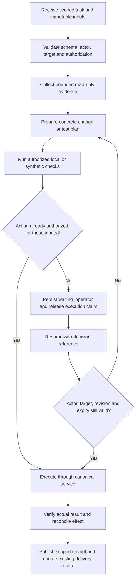

# Agent messaging and execution framework review — 2026-09-16

Research and proposed contracts; no new runtime, installation, provider call,
service, approval or deployment is established by this document. Primary official
pages were opened on 2026-09-16. The **OpenAI Docs** skill was used for Codex guidance.
Recommendations rank fit to this repository, not popularity. Local comparison used
the [LangGraph guide](../architecture/langgraph-integration.md), the
[document orchestration review](2026-09-16-document-orchestration-review.md),
[roadmap](../../roadmap.md) and [active delivery plan](../../plans/2026-09-14-delivery-reliability-and-jan-v1.md).
The inspected checkout was `995c945fd3ebf13b20bc90a340796927dadaf5c9` with
inherited unstaged/untracked changes; no runtime claim is attached to that SHA.

Keep the deterministic Python commands and domain services. First standardize
their task/result receipts and verify timeout/recovery behavior. Add a thin agent
adapter only where unattended delegation is useful. Test LangGraph independently
against a smaller durable-receipt implementation. A new protocol cannot make a
model's success statement into evidence of a successful child command.

## Options compared with the current application

| Rank / option | Useful capability | Fit and actual gap | Operating cost / disposition |
|---|---|---|---|
| 1. Existing Python CLI plus structured local receipts | Explicit argv, process status, artifact identity and a small durable state machine | Existing runners, private logs, A1 manifests and Django OcrRun already carry parts of this contract. The current handoff dispute calls for inspected terminal receipts and artifact binding | Lowest added dependency burden; extend existing entrypoints under REL-03/REL-06. No general-purpose replacement runner |
| 2. Version-pinned Codex/Cline adapters | Structured agent events, session continuation and supported control interfaces | Useful for bounded source/research delegation. Provider output is advisory; canonical validators still establish application results | Additional process, credential and schema lifecycle. Prototype with synthetic inputs and blocked external inference first |
| 3. Local LangGraph | Persistent branching, checkpoints, interrupt/resume | Useful experiment for crash recovery and longer review workflows. Existing Django review and OcrRun ownership remain authoritative | Checkpoint storage, version migration, replay handling and dependency burden. Optional OCR-CORE-10/11/13/14 experiment |
| 4. MCP plus A2A where independently needed | MCP exposes tools/resources; A2A standardizes remote agent task exchange | Neither is a prerequisite for two local CLIs. Existing service methods do not need to become network endpoints merely for consistency | Authentication, version negotiation and task lifecycle add work. Prefer local tool adapters; defer remote federation until a concrete consumer exists |
| 5. Temporal | Durable workflow history, workers, retries and activity lifecycle | Potential later fit for long multi-host operational workflows; exceeds the demonstrated local QA handoff need | Another service, persistence, worker deployment and recovery contract. Evaluate only if fleet workflow requirements justify it |

The existing architecture guide is illustrative: its `scripts/core/` tree does not
match the canonical `scripts/a1_core.py` and `scripts/finalize_a1.py` paths, and its
provider fallback example is not authorization to call an external OCR service.
The newer document orchestration review already describes the stronger approach:
retain domain authorization, immutable source revisions and local processing.

## Codex and Cline: use supported interfaces, pin the actual versions

`codex exec --json` emits JSONL events; normal mode sends progress to stderr and
the final response to stdout. `--output-schema` constrains the final response.
That schema validates shape, not whether a reported check ran. Capture process
termination and actual validator receipts as separate facts. [Official
non-interactive documentation](https://learn.chatgpt.com/docs/non-interactive-mode).

Codex App Server exposes bidirectional JSON-RPC with request IDs, thread/turn/item
identities, streamed events, approvals and `turn/interrupt`. It can generate schemas
for its installed version. Current documentation labels the command and WebSocket
transport experimental and unsupported for production and warns that non-loopback
WebSocket listeners can allow unauthenticated access by default. A local stdio
experiment avoids opening another listener; application scope checks still apply.
[Official App Server documentation](https://learn.chatgpt.com/docs/app-server).

The TypeScript Codex SDK starts, continues and resumes local threads. Current
official guidance says `codex mcp-server` and the standalone server binary were
removed; do not build a new integration around an old tutorial using them. This is
current documentation, not a statement that every installed binary has already
changed. [Official Codex SDK documentation](https://learn.chatgpt.com/docs/codex-sdk).

Cline documents JSON output, task timeout, isolated state directories and explicit
tool approval settings; CLI auto-approval defaults to true, with a different default
in ACP mode. Pin the intended settings rather than inherit defaults. The reference
shows `say`/`ask` JSON messages, whereas the upstream main README demonstrates
`agent_event` wrapping. This documented difference is sufficient reason to test
adapters against the installed release, not assume a universal event schema.
[CLI reference](https://docs.cline.bot/cli/cli-reference),
[upstream CLI README](https://github.com/cline/cline/blob/main/apps/cli/README.md).

The upstream README also documents non-TTY refusal when terminal approval is
required, plus desktop approval through matching request/decision files. Do not
turn on blanket auto-approval merely to avoid headless blocking. Use a supported
approval channel or stop with an explicit authorization requirement.
[Upstream approval behavior](https://github.com/cline/cline/blob/main/apps/cli/README.md#tool-approval).

Cline supports ACP, whose purpose is editor-to-agent communication. ACP is useful
for an editor integration; it is not the fleet workflow scheduler or A2A task
protocol. [Cline ACP](https://docs.cline.bot/usage/acp),
[ACP introduction](https://agentclientprotocol.com/get-started/introduction).

Do not run `doctor`, `update`, authentication, schedules or hub-start commands as
read-only version probes. Inspect installed `--version`/`--help` and release-matched
schemas first. Reading provider files is unnecessary. CLI availability, an existing
login and a paid subscription never establish the project's required zero-cost
authorization for a new automated provider request.

## MCP, A2A and durable execution are different layers

MCP stdio carries newline-delimited JSON-RPC on stdout; diagnostics belong on
stderr, whose presence is not itself failure. HTTP requires its own authentication
and origin protections. [MCP transport specification](https://modelcontextprotocol.io/specification/2025-11-25/basic/transports).
MCP 2025-11-25 also defines **experimental Tasks** with polling, result retrieval,
cancellation and task capabilities. It is therefore inaccurate to say MCP has no
job lifecycle. A supporting receiver must still implement execution, storage and
application authorization. [MCP Tasks](https://modelcontextprotocol.io/specification/2025-11-25/basic/utilities/tasks).

A2A defines discovery, messages, task/artifact updates and cancellation across agent
services. Its current specification makes action authorization implementation-owned:
entering `AUTH_REQUIRED` does not grant authority, and a resolved authorization does
not automatically authorize later messages. Task IDs and context IDs correlate
work; they are not credentials. Pin the negotiated protocol version and enforce
authenticated caller scope on task reads, cancellation and resume. [A2A specification](https://a2a-protocol.org/latest/specification/).

LangGraph checkpoints persist graph state; in-memory savers lose it on restart.
[Persistence](https://docs.langchain.com/oss/python/langgraph/persistence).
An interrupted node starts again on resume, so prior side effects must tolerate
repetition. A separate write node still needs idempotency for crashes and replay.
[Interrupts](https://docs.langchain.com/oss/python/langgraph/interrupts).
`sync` persistence writes checkpoints before the next step; replay can execute
downstream nodes again. It does not turn an independent Django transaction into
exactly-once delivery. [Checkpointers and durability](https://docs.langchain.com/oss/python/langgraph/checkpointers).

Temporal keeps workflow execution state/history and schedules work through its
service and workers. Activities have timeout/retry behavior; cancellation requires
activity cooperation, including heartbeats for receiving service cancellation.
It still needs idempotent external effects and supervised subprocess cleanup.
[Workflow execution](https://docs.temporal.io/workflow-execution),
[Activity execution](https://docs.temporal.io/activity-execution).

## Proposed minimum message and receipt contract

This section is a design for REL-03/REL-06, not an implemented CLI adapter.
Start its minimal envelope/approval definitions in the single
`config/agent_ops_workflow.v1.json` contract; split standalone interchange schemas
only when a real integration requires them.
Keep domain audit in `AuditEvent` and `scripts/a1_audit.py`; orchestration receipts
reference those records and do not create another sensitive-action audit system.

| Group | Required meaning |
|---|---|
| Identity | `schema_version`, unique `message_id`, `task_id`, `run_id`, `attempt_id`, `parent_run_id`, `correlation_id`, `causation_id`, monotonic per-run `sequence` |
| Authority | Authenticated `actor_ref`, `delegator_ref`, exact owned paths/actions, `target_ref`, data class, authorization reference; receiver verifies identity instead of trusting self-reported names |
| Inputs | Source commit or reviewed working-tree identity; dependency/settings identity; input artifact refs/revisions; workflow and adapter versions. Never hash/serialize the protected service EnvironmentFile |
| Execution | Allowlisted executable and argv, cwd, environment profile ID, task deadline, heartbeat threshold, cancellation grace, attempt budget, operation/idempotency key |
| Evidence | Start/end UTC time and monotonic duration, child exit code or signal, terminal reason, validator outcome, opaque log/artifact refs and protected identity checks |
| Decision | Requested action, exact target set, source/artifact revision, policy version, deciding actor, decision, expiry and single-use/reuse scope |

Reject unknown major schemas, duplicate sequence conflicts, changed input identity
under a reused operation key, out-of-scope paths and stale decisions. Duplicate
delivery of the same operation returns its existing receipt. UUIDs correlate work;
they do not enforce access. Each receiver authenticates and rechecks authorization.

Use explicit lifecycle states: `queued`, `running`, `waiting_operator`, `succeeded`,
`failed`, `timed_out`, `cancelled`, `unknown`. These are proposed run states, separate
from the plan-status vocabulary. A missing receipt, disconnected client or elapsed
tool wait becomes `unknown` until reconciled. It never becomes success by default.
Store implementation, validation, publication, deployment and operator acceptance
as separate evidence fields, not one generic `done` value.

Keep protocol stdout and diagnostics separate; preserve original failure attempts.
The supervisor owns one process group/session and tracks it through termination and
cleanup. A short UI/tool polling interval is distinct from a child deadline. On
disconnect, reconcile the owned process and receipt before launching a retry. On
deadline, request cancellation, await a bounded grace period, terminate only owned
children and record the observed result. Do not use global process-name killing.
Python's subprocess API distinguishes exit status, signal and timeout and supports
argv/environment/process-group control. [Python 3.13 subprocess](https://docs.python.org/3.13/library/subprocess.html).

An isolated checkout protects source ownership, not credentials or PII. Run agents
with explicit environment allowlists and filesystem/network containment where
needed. A same-user directory instruction or `0700` directory cannot isolate one
same-user agent from another. Logs, agent session history and checkpoint storage
are protected surfaces too; redact at production, retain privately and reference
opaque artifacts in summaries. No source scans, raw OCR, cookies, credentials or
environment dumps enter prompts/telemetry. Hosted tracing remains off.

## Proposed workflow and operator boundaries



This graph is a proposed behavior model; it does not require LangGraph to implement
the first local receipt increment. A future graph adapter wraps canonical services,
stores opaque refs and uses a durable saver in private storage. It must not start a
second scheduler for an OcrRun, hold a DB transaction while waiting for a human or
treat `Command(resume=...)` as authorization.

| Action | Autonomous boundary | Operator wait when |
|---|---|---|
| Research, source review, scoped synthetic checks | Existing in-project authorization and delegated non-PII paths | Missing required business fact or operation authority |
| Health observation | Named inventory and bounded read-only probes; per-host result including unreachable/unknown | Access or scope must expand; observation does not authorize repair |
| Local code/docs/tests and feature-branch delivery | Repository's existing engineering/commit/push authorization | Separate restricted action such as protected merge or new remote |
| Ansible validation | Review exact inventory, playbook, roles and selected task behavior; syntax/selection/check receipts have separate meanings | Actual host mutation lacks matching authorization, target identity or rollback prerequisites |
| Host apply/restart/configuration | Reuse explicit existing authorization for the exact scope | A new action/host/revision exceeds it; prepare the concrete diff first |
| Human fact confirmation / real-data activation / A1 promotion | Existing domain rules and authorized actor only | Required source-bound review/activation decision absent or stale |

Ansible check mode is simulation, not deployment acceptance. Tasks with
`check_mode: false` can make changes even during `--check`; unsupported modules and
conditionals can leave gaps. `--diff` can reveal sensitive values. Inspect selected
tasks and suppress secret diffs before declaring a run read-only. Report coverage
per host/service/site and explicitly mark skipped, unsupported, unreachable and
unverified cases. [Ansible check/diff documentation](https://docs.ansible.com/projects/ansible/latest/playbook_guide/playbooks_checkmode.html).

## Proposed organization, versioning and next evidence

Keep existing plan IDs and the 34-entry catalog. Use REL-03 for receipt/source
binding, REL-06 for adapters/boundaries and OCR-CORE-10/11/13/14 for the optional
graph experiment. Infrastructure inventories, desired state and Ansible code stay
owned by the infrastructure repository; this application stores its consumer
contract and links to reviewed revisions, not a second fleet authority.

```text
config/agent_ops_workflow.v1.json               # one synthetic workflow contract
scripts/research_agent_ops_workflow.py          # local experiment; no shell/AI/network
tests/test_agent_ops_workflow.py                # synthetic workflow invariants
docs/architecture/agent-operations-workflow.md   # operations and operator boundaries
docs/architecture/langgraph-integration.md      # shared architecture guidance
docs/research/2026-09-16-agent-messaging-frameworks.md
plans/2026-09-14-delivery-reliability-and-jan-v1.md
docs/operations/git-delivery.md                 # one delivery status record
runtime/portal/temporary/agent-ops-<uuid>/        # private, ignored run receipts
output/provisional/<scoped-package>/            # A1 artifacts/previews stay canonical
```

The primary integration owns those demonstration paths; this research does not
certify their implementation. Keep current repository naming: kebab-case Markdown,
snake_case Python and the selected `agent_ops_workflow.v1.json` contract name.
No additional daemon or parallel approval/audit store is proposed. Schema majors
live in filenames and payloads; additive
compatible changes retain the major. Pin workflow/adapter versions for suspended
runs and reject unsupported migrations. Use UUIDs for run directories, fixed
`request.json`, `events.jsonl`, `receipt.json`, `stdout.log`, `stderr.log` names
within each run, and retain attempts individually. Atomic terminal receipt writes
and a single owned event writer prevent partial success from being advertised.

The first graph demonstration uses deterministic synthetic steps without shell,
model or network tools. The subsequent CLI adapter demonstration should use a
synthetic child command: clean success,
nonzero exit, malformed/truncated JSON, disconnect while still running, cancellation,
duplicate request and stale approval. Check that a false model completion cannot
override the child receipt, an inherited credential never reaches the child, source
drift invalidates reuse and stderr does not break JSON parsing. Then run one real
canonical synthetic validation through the adapter and inspect its artifacts.
This is stronger evidence than a parser-only or schema-only success.

For optional LangGraph, retain the existing two-day comparison limit and fault
matrix in the document orchestration review. Add crash-after-domain-commit,
checkpoint-write failure, concurrent resume, revoked actor and graph-version change.
Adopt only if recovery/maintenance benefits beat small Django stage receipts with
the same engines and inputs. No automatic human confirmation, external data
dispatch or duplicated effect is acceptable. Fleet deployment needs separate
intended-host, effective-configuration, smoke, rollback and recovery evidence;
none was collected by this research subtask.
