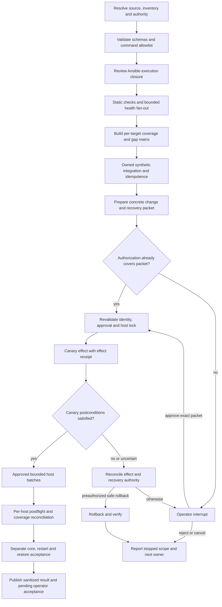

# Bounded fleet validation and LangGraph workflow

Date: 2026-09-16. Status: research proposal; not deployment authority.
Scope: REL-03/REL-05/REL-06 and INFRA-PG-01 under the existing
[delivery plan](../../plans/2026-09-14-delivery-reliability-and-jan-v1.md).
This document proposes orchestration around existing commands. The bounded
[implemented synthetic demonstration](../architecture/agent-operations-workflow.md)
has a narrower contract; its actual limits and tests are recorded there. This
design does not replace application services, create another audit schema, or
activate CI.

Use deterministic Python orchestration and the existing infrastructure Ansible
workflow first. Measure a small local LangGraph adapter for resumable decisions
and explicit state transitions. A model is unnecessary for this graph. Keep
fleet deployment in the operational infrastructure repository and application
acceptance in this repository. The infrastructure core shadow repository must
not become production authority through an automation experiment.

The current session's actual fleet observations and executed checks belong in
`docs/operations/2026-09-16-agent-ops-review.md`, maintained by the primary agent.
Historical statements below are document observations, not new host measurements.

## Existing controls and the gap this would close

| Area | Existing implementation or contract inspected | Proposed increment / evidence still needed |
|---|---|---|
| Ownership | `AGENTS.md` gives the primary integration/publication and sysadmin host ownership; scoped non-PII delegation is allowed | A work order binds each agent to explicit paths, tools, target aliases and prohibited data; recheck at every execution boundary |
| Infrastructure source | Runtime contract references server61 core desired-state material; primary is reconciling core shadow versus legacy operational authority | Resolve operational repository, inventory, revision and controller before any execution; a desired-state file alone cannot authorize apply |
| Validation | `change-packages.yml`, selectors, mandatory hooks and private receipts exist | Reuse them; attach their actual tested source/dependency/settings identities to graph results rather than adding a second test runner |
| Runtime identity | Manifest validation and separate `/health/` and `/readiness/` contracts exist | Verify deployed bytes and named target independently; HTTP 200 and a declared build identifier cannot certify installation or user journey |
| Database ownership | Provisioning-return contract and disposable-target guards exist; live ownership/credential/timeout gaps remain tracked | Require trusted provisioning evidence before isolated migration, cleanup or restore; graph state cannot mint ownership |
| Approval | Existing project/operator rules distinguish source delivery, host changes, real-data activation and issuance | Carry authorized scope forward; wait only for a concrete missing authorization, never for routine engineering choices |
| Documentation | Roadmap and child plan retain unresolved JAN and PG5 work; later triage prose claims only one remaining blocker | Reconcile against executed evidence. A passing suite cannot eliminate separate restore, deployment, routing or operator acceptance gaps |
| Orchestration | Existing OCR worker and services remain v1 default; LangGraph comparison is optional | Add no canonical dependency or hosted tracing until the synthetic comparison demonstrates a useful recovery advantage |
| CI | GitHub `origin` exists; GitLab/CI proposal remains inactive under DEC-016 | Local checks continue. New remote, runner, hook or CI activation needs its own authorization |

The inherited triage report also promotes unsupported causal inferences: an empty
journal does not identify why entries are missing, a truncated process username
does not establish a different identity, a peer listing does not prove health,
and historical static-file errors do not establish current routed serving.
The workflow must retain observations, hypotheses and acceptance as separate
fields. Host diagnostics, not prose confidence, close these gaps.

## Technology choices for this repository

These are fit assessments, not popularity rankings or new approved dependencies.

| Choice | Useful capability | Cost / limit here | Disposition |
|---|---|---|---|
| Existing Python, receipts and Ansible | Smallest change; domain and infrastructure ownership already exist | Requires explicit state and recovery contracts | Baseline; implement bounded evidence handling here first |
| Local LangGraph `StateGraph` | Conditional stages, interrupts, checkpoint recovery; no LLM needed | Checkpoints, resume authorization and external-effect reconciliation still need application controls | Preferred bounded comparison; keep optional and isolated |
| Ansible + Molecule | Infrastructure convergence and repeat-run verification on disposable resources | Drivers and scenario cleanup are executable infrastructure operations; not intrinsically safe | Use within the infra owner's reviewed disposable-target lifecycle |
| Temporal | Durable workflow execution with separately executed activities | Additional server/worker operations and integration burden; activities still need idempotency | Defer unless measured distributed/recovery needs exceed existing tooling |

LangGraph supplies graph orchestration; its examples do not require an LLM.
[Official overview](https://docs.langchain.com/oss/python/langgraph/overview).
Temporal separates durable workflows from activities that may be retried; this
does not remove the need to make external effects safe to repeat.
[Workflow execution](https://docs.temporal.io/workflow-execution),
[activities](https://docs.temporal.io/activities).

## Evidence levels and execution boundaries

| Stage | Autonomous scope under existing task authorization | Proof and limits | Wait condition |
|---|---|---|---|
| Source review | Explicit nonsecret files, inventory aliases and Git metadata | Syntax/structure/ownership; not host state | Unresolved operational authority or protected material outside scope |
| Syntax/list/lint | Reviewed controller/config/plugins with static sanitized inventory; no production secrets | Parser, selection and declared tasks only; dynamic includes may be incomplete | Unreviewed inventory/lookup/action/callback plugin or controller write |
| Read-only health | Allowlisted service metadata, bounded connectivity/TLS and approved GET/HEAD endpoints | Fresh point-in-time observation per target/vantage | Missing route/access contract; unknown endpoint safety; no authority to inspect needed data |
| Ansible check | Reviewed complete playbook dependency closure, explicit target limit, safe controller and task behavior | Predicted changes for supported tasks; skipped/unsupported tasks remain untested | `check_mode: false`, unreviewed delegation/lookup, secret diff, ambiguous includes or unapproved writes |
| Isolated integration | Exclusively owned disposable target, synthetic inputs, explicit cleanup contract | Actual convergence, behavior, idempotence and failure handling on that target | Target not proven disposable/owned, setup requires host change, cleanup authority absent |
| Canary apply | Only when existing or newly recorded authorization covers exact revision, host, effects and recovery | Actual change plus host/service postconditions | Missing bound authorization; unhealthy baseline; unreconciled external process |
| Remaining host batches | Authorized enumerated hosts and batch policy after canary postconditions | Coverage for those hosts, not unenumerated fleet | Scope expansion, drift, stop threshold, revoked/expired authorization |
| Rollback | Exact preauthorized rollback, verified compatibility and named owner | Measured recovery of supported state | Unapproved recovery action, destructive schema/data step, uncertain effect |
| Restore test | Owned disposable destination, approved backup handling and consistency contract | Measured DB-and-files recovery and applicable RPO/RTO | Real-data access/target authority absent; key access unavailable |
| Acceptance | Run identified committed-source synthetic core journey and retain separate operator outcome | Application behavior, then human usability acceptance | Human observation required; real-data activation remains §14 decision |

Read-only observations may produce ordinary access/audit logs and probe load;
bound rate and payload size. Never retrieve page bodies, environment payloads,
cookies or journal contents simply to fill a health matrix. Liveness, readiness,
authentication, static delivery, migration status, core workflow, restart
persistence and restore are separate columns.

Ansible `--check` is simulation with task-level exceptions: `check_mode: false`
executes normally, unsupported modules may contribute no evidence, and `--diff`
can reveal sensitive file contents. Avoid blanket diff; review `diff: false` on
secret-bearing tasks.
[Check and diff modes](https://docs.ansible.com/projects/ansible/latest/playbook_guide/playbooks_checkmode.html).
Delegation can reach targets outside the limited host set; include delegated
hosts and controller effects in scope.
[Delegation](https://docs.ansible.com/projects/ansible/latest/playbook_guide/playbooks_delegation.html).
Lookups execute on the control node, so `--syntax-check`/inventory/list commands
must not be treated as a sandbox for untrusted repository code.
[Lookup plugins](https://docs.ansible.com/projects/ansible/latest/plugins/lookup.html),
[playbook CLI](https://docs.ansible.com/projects/ansible/latest/cli/ansible-playbook.html).
`no_log` does not protect debugging output; explicitly disable debug verbosity,
sanitize callbacks and prevent secrets reaching traces before persistence.
[Ansible logging](https://docs.ansible.com/projects/ansible/latest/reference_appendices/logging.html).

Molecule's effective sequence must be inspected before invocation. Its lifecycle
can provision, converge and destroy targets. Idempotence checks rerun convergence
and look for zero changes; add service/domain assertions because `changed_when:
false` can conceal effects and a no-change result is not functional correctness.
Use the repository's pinned version and effective scenario, not an assumed
default sequence from a different release.
[Molecule workflow](https://docs.ansible.com/projects/molecule/workflow/).

## Proposed graph



Every execution node has a failure edge to `classify_failure`; required failure
prevents downstream apply for the affected target/change. Independent read-only
targets may continue. `classify_failure` chooses bounded retry, reconcile,
operator wait or terminal report; it never manufactures a pass. The static and
health branches can run in parallel after authority review. Mutations of a
shared target are serialized by a trusted lease/lock, not by agent convention.

The review-only profile terminates after the coverage matrix. A synthetic profile
terminates after isolated integration. Apply nodes do not exist in the initial
executable demonstration; its simulated effect is a local synthetic row.

### State and validation contract

Proposed `schema_version: 1` and `workflow_id: fleet-validation-v1` identify this
contract. Validate envelopes at input, every node output, checkpoint resume and
result export; Python type hints alone are not runtime validation. Pin graph
source revision and dependency lock identity independently of schema version.
LangGraph's documented Pydantic integration does not validate every intermediate
node output automatically.
[Graph API](https://docs.langchain.com/oss/python/langgraph/use-graph-api).

| State field | Meaning |
|---|---|
| `run_id`, `request_id`, `parent_run_id` | Opaque correlation identifiers; no employee names or credentials |
| `schema_version`, `workflow_id`, `graph_revision` | Decoder and workflow identity; unknown versions fail closed |
| `source` | Repository ID, commit, explicit file identities, dependency/collection lock, tested-source kind; no secret config digest |
| `authority` | Operational repository/policy reference and inherited authorization references |
| `targets` | Explicit target aliases, inventory revision and permitted action classes; unknown fields stay null |
| `checks` | One result per target/stage/check/input identity with native exit, category, timing and private evidence reference |
| `approval_ref` | Reference to independently authenticated bound decision; not a user-supplied boolean |
| `effects` | Action IDs and pending/observed/verified status; no command-generated secret values |
| `coverage` | Expected, observed, failed, blocked, untested and not-applicable counts with reasons |
| `failure`, `attempts`, `deadline_at` | Sanitized error category, bounded counters and deadline; waiting is explicit |
| `limitations`, `next_owner` | What the result does not establish and who can resolve it |

Result vocabulary: `passed`, `failed`, `blocked`, `untested`, `not_applicable`,
`cancelled`, `waiting_operator`, `uncertain_effect`. Applicability needs an
explicit rule/owner; omitted hosts are `untested`. These runtime values do not
replace the controlled planning status vocabulary in `plans/INDEX.md`.
Do not convert process exit 2 into a global meaning: preserve native exits and
interpret them through each command's documented adapter. A CLI wait/yield is
not process failure or permission to restart it.

### Failure classes and initial bounded budgets

These are proposed experiment defaults; infrastructure chooses production
deadlines from measured workloads. All attempts retain their original receipts.

| Category | Automatic response |
|---|---|
| `invalid_scope`, `untrusted_source`, `unsafe_check`, `privacy_violation` | Stop before execution; no retry |
| `authentication`, `authorization`, `unknown_ownership` | Block affected scope; no guessed credentials or target substitution |
| `dns`, `connect_timeout`, `transient_health` | At most 3 total read-only attempts, 2s then 5s backoff, at most 10s per probe; report each |
| `syntax`, `assertion`, `test_failure`, `unexpected_change` | No unchanged rerun; investigate smallest distinguishing case |
| `source_drift`, `inventory_drift`, `approval_expired` | Invalidate affected evidence/decision, rebuild concrete packet |
| `process_running` | Reattach/poll owned process; heartbeat every at most 30s; do not spawn duplicate |
| `mutation_timeout`, `lost_connection_after_apply`, `checkpoint_failure` | Mark effect uncertain, reconcile observed target before any retry |
| `cleanup_failed`, `restore_failed` | Retain resources/evidence, report failure and owner; never swallow error |
| `operator_wait` | Persist and stop worker; no inference from elapsed time; expire approval according to policy |

Proposed execution budgets: 30 transitions, 5 minutes active execution,
one concurrent effect per target. The delivered local experiment enforces the
transition bound; it does not implement a general wall-clock deadline or a
distributed target lease. Long application checks retain their measured
command budgets; a 30-second UI tool interval must not become their deadline.
Graph recursion limits are an additional loop guard, not a command timeout.
[LangGraph recursion limit](https://docs.langchain.com/oss/python/langgraph/errors/GRAPH_RECURSION_LIMIT).

## Resume authorization, effects and private records

An interrupt restarts its node on resume. Keep that node pure: prepare the request
before it, validate the answer after it, and execute effects in a separate node.
Re-authorize caller, organization/scope, decision, source and target on every
resume. A thread ID selects stored state; it is not a permission token.
[Interrupt semantics](https://docs.langchain.com/oss/python/langgraph/interrupts).

Proposed decision envelope: `decision_id`, `actor_ref`, `decision`,
`authorization_ref`, `issued_at`, `expires_at`, `request_id`, `graph_revision`,
`source_commit`, `inventory_revision`, enumerated targets, permitted action IDs,
effect parameters digest over nonsecret values, rollback scope and concurrency
limit. The trusted approval adapter resolves identity and authority; graph input
cannot self-assert them. A changed revision/target/action invalidates the decision.
An already applicable authorization proceeds without asking again. Revocation
is checked immediately before every host effect, including later batches.

Claim an effect using a unique `(request_id, action_id, target, desired_revision)`
key and a trusted target lease. Persist intent, execute, inspect postconditions,
then retain the result. A local atomic transaction can deduplicate the synthetic
effect; a remote Ansible command and checkpoint are not one transaction. A crash
between them requires reconciliation, not an exactly-once claim. Never resume
an old checkpoint into live mutation until effect state is reconciled; sandbox
replay uses synthetic targets and new run identity.

LangGraph checkpoints preserve state between graph steps; replay can re-execute
later nodes. Use a persistent saver and synchronous durability for the experiment's
restart case; an in-memory saver cannot demonstrate restart recovery. This still
does not make remote effects atomic. Disable pickle fallback and keep checkpoint
payloads restricted to validated primitive data.
[Checkpointers, replay and durability](https://docs.langchain.com/oss/python/langgraph/checkpointers),
[persistence](https://docs.langchain.com/oss/python/langgraph/persistence).

Keep local orchestration metadata distinct from application audit. Where the
workflow performs an application-sensitive action, use existing `AuditEvent` or
`scripts/a1_audit.py`; do not invent a competing audit-event schema. Store only
opaque evidence references and sanitized result categories in graph state.
Exclude raw stdout, environment dictionaries, credentials, cookies, documents
and source PII from checkpoints, exceptions, traces and inter-agent messages.
Disable external tracing/exporters and remove inherited provider credentials
from the experiment process. Private artifacts remain under this repository
with 0700 directories and 0600 files; apply the existing retention/hold policy.

## Small demonstration and acceptance cases

Implement one optional synthetic adapter around a deterministic policy function.
No SSH, Ansible apply, model call, paid service, real database or production secret
is needed. Use fictional targets `synthetic-app-a` and `synthetic-app-b`; local
SQLite contains only synthetic checkpoint/effect metadata. Put dependencies in
an isolated in-repository environment; record exact installed versions without
changing canonical `venv` or requirements. No hosted LangSmith setup is needed.

Minimal graph definition to adapt, not an installed runner:

```python
from langgraph.graph import END, START, StateGraph
from langgraph.types import interrupt

def await_decision(state):
    # Pure, serializable request; no side effect before interrupt.
    decision_ref = interrupt(state["approval_request"])
    return {"decision_ref": decision_ref}

# Adapters below are supplied by the synthetic harness and validate each output.
builder = StateGraph(State)
builder.add_node("preflight", preflight)
builder.add_node("await_decision", await_decision)
builder.add_node("validate_decision", validate_decision)
builder.add_node("synthetic_effect", synthetic_effect)
builder.add_node("verify", verify)
builder.add_node("refuse", refuse)
builder.add_edge(START, "preflight")
builder.add_conditional_edges("preflight", preflight_route)
builder.add_edge("await_decision", "validate_decision")
builder.add_conditional_edges("validate_decision", decision_route)
builder.add_edge("synthetic_effect", "verify")
builder.add_edge("verify", END)
builder.add_edge("refuse", END)
graph = builder.compile(checkpointer=persistent_synthetic_checkpointer)
```

The synthetic decision adapter must be visibly marked as a test authority; a
caller-supplied fixture is never operational approval. Demonstrate these cases:

1. Start, pause before effect, terminate process, reopen checkpoint, accept the
   matching synthetic decision, observe exactly one synthetic effect.
2. Reject, expire, revoke, change actor scope, revision or target: no effect.
3. Resume twice and crash after effect before graph checkpoint: retained unique
   effect/reconciliation prevents a second effect.
4. Required preflight failure and unsafe check-mode fixture: cannot reach effect.
5. One unreachable synthetic target: coverage remains incomplete, other read-only
   results remain usable, global fleet success is false.
6. Missing/malformed evidence and source drift: result cannot become passed.
7. Synthetic secret canaries and malicious log instruction: canary absent from
   exported state/logs; log text cannot change allowed commands or decisions.
8. Changed graph/schema version and retention-deleted checkpoint: explicit refusal
   or reviewed migration; no silent fresh run masquerading as continuation.

Compare this with the same policy implemented by the existing Python receipt
pattern. Adoption requires demonstrable recovery/maintenance value with no loss
of domain authorization or evidence quality. The demonstration establishes only
synthetic orchestration semantics. It cannot certify live deployment, app
acceptance, host availability, production approval or DB/files restore.

## File placement, versioning and next bounded work

Keep source and sanitized policy in Git; private execution artifacts remain out.
Reuse existing folders and task IDs. The implemented experiment uses the paths
below; live orchestration remains proposed. Its runbook describes the actual
execution and evidence boundaries.

```text
AGENTS.md                                  existing authority; avoid incident rules
roadmap.md                                 outcomes and meaningful checkpoints
plans/2026-09-14-delivery-reliability-and-jan-v1.md
                                           authoritative REL/INFRA TODOs + owners
docs/research/2026-09-16-devops-workflow-design.md
                                           comparison and proposed experiment
docs/operations/2026-09-16-agent-ops-review.md
                                           primary's sanitized current-state review
docs/operations/git-delivery.md             one delivery/publication record
docs/decisions/ADR-NNN-short-title.md        only after an actual adoption decision
config/agent_ops_workflow.v1.json            synthetic policy/version contract
config/agent_ops_workflow.v1.requirements.txt
                                           isolated resolved dependency versions
scripts/research_agent_ops_workflow.py      synthetic demo + --validate-contract
tests/test_agent_ops_workflow.py            synthetic refusal/recovery regressions
docs/architecture/agent-operations-workflow.md
                                           actual runbook and implementation limits
runtime/portal/temporary/agent-ops-<UTC>-<uuid>/
  receipts/ logs/ checkpoints/              private; never tracked or copied out
```

Operational inventory, playbooks, role tests and Molecule scenarios stay in the
infrastructure owner's canonical operational repository. Reference its revision
and receipt ID here; do not duplicate inventory/credentials or silently promote
core shadow files. Configuration schemas use explicit integer versions; breaking
changes add a decoder/migration or reject old runs. Python filenames use
`snake_case` and established `run_`/`validate_` prefixes; documents use dated
`kebab-case`; run IDs use UTC plus opaque UUID. Do not use `final`, `latest` or
modification time as artifact authority.

Next work under existing IDs: REL-06 reconciles disputed claims and command
lifecycle; REL-03 implements and tests the bounded synthetic state/evidence
contract; REL-05 maps reviewed Ansible/CI stages without activating new CI;
INFRA-PG-01 returns target/controller authority and concrete host recovery packet.
JAN-04 still requires identified committed-source core/restart evidence, and PG5
still requires a separate owned restore demonstration. Missing fleet access or
host approval does not block local synthetic work.
