# Dependency updates and document orchestration review — 2026-09-16

Research and engineering review, not an accepted architecture change. Owners:
PLAN-WORKERS for OCR; PLAN-INFRA for environment reproduction and delivery.
Execution remains in the [delivery plan](../../plans/2026-09-14-delivery-reliability-and-jan-v1.md)
and [OCR child plan](../../plans/2026-09-06-ocr-shared-core-local-web.md).

## Recommendation and outcome

Keep Django, the shared Python document processor, local RapidOCR and the existing
human review services for core v1. Repair the measured environment, test-target and
workflow gaps first. LangGraph is worth a bounded synthetic comparison for expensive
multi-stage recovery and conditional fallback; it is not a prerequisite for Jan's
workflow, an OCR engine upgrade, or evidence of more accurate extraction.

The outcome remains: upload → local field proposals → explicit review/correction →
protected download, with tenant isolation, exact source revision and durable state.
Unknown fields remain unknown. Official A1 issuance stays outside core acceptance.
No LangGraph package, model API, tracing service or new worker was installed by this
review. The existing `venv/` remains the canonical environment; `.venv/` is absent.

## Sources and evidence boundary

Inspected baseline: `4a38067`, including committed shell repair `b687abe`, plus
explicitly uncommitted dependency and PostgreSQL changes. The user-supplied install
report is a claim to check, not an executable receipt. Source references below were
read directly; package metadata and model RECORD entries were inspected locally.
Public references were checked on 2026-09-16; their moving versions are not project pins.

Private source identities and native results:
`runtime/portal/temporary/ocr-orchestration-review-20260916-3iu4h9nx/`.
No protected runtime configuration, operator database or real document was read.
This review did not repeat intended-host health, authentication or browser acceptance.

| Executed evidence | Result | Limit |
|---|---|---|
| `venv/bin/python -m pip check` | No broken requirements | Metadata consistency of this installed environment only |
| Real `test_real_ocr_document_semantics_offline` cases under `unshare -Urn` | 3 passed; 27.77 s command duration | Generated OP/EHIC/passport examples; network disabled; not real-scan accuracy |
| `manage.py test tests.document_web.test_ocr_worker --noinput` with document-test settings | 18 passed; system check clean | Isolated SQLite and scripted processor; queue/review boundaries, not PG concurrency or real-browser acceptance |
| Guard/resolver focused pytest modules | 29 passed | Mostly synthetic/mocked contracts; not complete cleanup integration |
| Additional isolated cleanup probe | Reproduced `KeyError: 'lock_key'`; no subprocess executed | New environment forwarding regression, not an operator DB test |

Final documentation-hook results belong to the [delivery record](../operations/git-delivery.md)
and private delivery receipt. No clean-environment installation or LangGraph spike
was executed; those remain explicit planned work.

## Review of the installation report

The added pins match installed `playwright 1.62.0`, `pytest-django 4.14.0` and
`PyOTP 2.10.0`. Direct use exists: the browser helper imports Playwright; onboarding,
accessibility and reviewer tests import PyOTP. Removing unused Python axe wrappers
matches `scripts/axe_check.sh`, which injects axe-core from a CDN. It still has a
network/runtime-asset dependency. `requests` is a RapidOCR dependency; no new direct
repository use was established. Avoid unrelated package installs.

| Finding | Required correction / expected evidence |
|---|---|
| `requirements-lock.txt` is a 55-package freeze snapshot, with no artifact hashes; `onnxruntime>=1.29` remains open in base requirements | Choose one documented base/dev/constraints installation contract, record resolver/platform identity and artifact hashes, and prove a fresh isolated build. Installed-package freeze is not a solved lockfile. [pip documentation](https://pip.pypa.io/en/stable/cli/pip_freeze/) |
| Base and dev requirements duplicate the same three pins; Ruff appears only in the snapshot while CI installs it unpinned | Establish one owner for each runtime/test/lint dependency and update actual consumers together. Avoid unrelated upgrades; moving all tooling between files without updating callers would break bootstrap |
| CI fast job installs base then snapshot, slow job uses base only; browser/system setup is absent from those jobs | Align existing bootstrap/CI/receipt semantics under REL-05. Verify browser executable plus native libraries and offline OCR assets from a clean environment; a cached browser launch cannot prove this. [Playwright browser installation](https://playwright.dev/python/docs/browsers) |
| Current Chromium metadata requires revision 1234; three ONNX model files used by the adapter exist and are listed in installed RapidOCR RECORD | Record the tested asset identities and provisioning procedure; confirm availability after fresh install. Existing files do not establish fresh artifact availability or a model-download contract |
| Report says allauth MFA depends only on FIDO2 | Installed allauth metadata lists both `fido2` and `qrcode` for MFA; PyOTP is a direct project tool/test dependency |
| Report states pytest-django requires pytest `<10`, and PyOTP is RFC 6238 only | Installed pytest-django metadata says `pytest>=7.0.0`, without that upper bound. PyOTP supports HOTP and TOTP. [PyOTP documentation](https://pyotp.readthedocs.io/en/stable/) |
| Report claims packages work because `pip list` shows them | Imports, real OCR, Django checks, browser journeys and cold bootstrap establish different things. No claim that Django/psycopg/cryptography versions form a verified compatibility matrix follows from their simultaneous presence |

Keep the working versions as the baseline for environment reproduction. This review
does not certify “latest security release”, every optional import, or compatibility
of future ONNX Runtime versions. Do not rename/create a second live environment to
match the report's `.venv` wording. A disposable bootstrap environment belongs inside
private project runtime and must not mutate the canonical `venv/`.

## Review of the concurrent implementation updates

`b687abe` closes the specific missing shell-file dependency: the migration invocation
now sets `PRACE_MIGRATION_SCOPE=1` and rejects the named operator target. This is
source completeness for that repair, not closure of all P0/JAN-04 acceptance.

The unstaged changes correctly address several prior findings at source level:
pure SQL for the psql probe, workflow-selection forwarding, migration-pair forwarding,
TLS-to-libpq mapping, explicit empty-target detection and blank database/user refusal.
Retain their scope, then validate/integrate them coherently. The positive real-PG
probe, effective migration/runtime role and timeout, and TLS integration remain open.

**New P0 regression:** `scripts/disposable_pg_guard.py::psql_env(values)` copies
`os.environ` rather than the supplied complete environment. The changed
`tests/test_rehearse_workflow.py::_cleanup_pg_operator` passes that result to
`verify_target`. A caller whose fixture owns the target only in its dictionary
loses target/ownership fields: verification returns the SQLite-default verdict, then
cleanup raises `KeyError: 'lock_key'`. With ambient PG variables it can inspect a
different/incomplete context. Ambient libpq TLS options are also retained when the
selected contract omits them. Fix explicit environment ownership and require a PG
verdict for PG cleanup; test the actual caller chain and conflicting ambient values.
The reproduction mocked subprocess execution, so no DELETE or connection occurred.

Independently provisioned ownership and a guard held across setup/workload/teardown
remain unresolved. A consumer-created marker plus table-wide DELETEs does not become
safe because the syntax probe or TLS mapping is repaired. See JAN-04.

## Current OCR architecture and actual gaps

```mermaid
flowchart LR
    A[Protected upload and immutable DocumentVersion] --> B[Pending OcrRun in Django DB]
    B --> C[Scoped process_ocr worker claims lease and attempt]
    C --> D[Shared DocumentProcessor]
    D --> E[Decode and segment]
    E --> F[Read original and enhanced crops with local RapidOCR]
    F --> G[Interpret fields and preserve disagreements]
    G --> H[Protected result and FieldProposal records]
    H --> I[Authenticated review with source revision token]
    I --> J[FieldDecision and WorkerIdentityRevision]
```

This is the inspected implementation, not proof of a running host supervisor.
`document_intake.py::queue_run/process_pending/execute_run` uses persisted OcrRun
rows, conditional claims, a 15-minute lease, attempt tokens and at most three total
attempts. Failed runs need explicit requeue; expired running leases are recoverable.
`process_ocr` reloads actor/tenant authorization for each batch. The shipped HTTP
path queues work; the shared callable still supports synchronous use. Older docs
saying the web path is inline are stale. django-q2 is installed and selected in
ADR-001, but this OCR consumer does not dispatch through it.

`src/document_core/pipeline.py` already provides deterministic segmentation,
original/enhanced comparison, field validation, side matching and worker proposals.
`field_review.py::confirm_review_batch` validates permission and exact revision in
a transaction; `FieldDecision`, `WorkerIdentityRevision` and `AuditEvent` remain the
authoritative records. Do not replace these controls with a graph approval boolean.

| Gap | First improvement in the existing solution |
|---|---|
| Retry reruns the processor; expensive intermediate stages are not durable resume boundaries | Measure repeated work, then consider source/model/config-bound stage receipts before selecting a graph framework |
| Native OCR runs synchronously; a lease is not a hard execution deadline or process cancellation | Add bounded owned-process execution/cleanup where measured hangs require it; test lease expiry and stale completion independently |
| Local fallback adapter exists but is CLI-only and uses process isolation | Decide whether a bounded second local engine improves the corpus. Its confidence floor is a routing heuristic, not calibrated correctness; do not silently wire it into threaded portal execution |
| Generated examples pass; document editions, difficult scans and unsupported layouts lack representative calibration | Extend synthetic labelled/negative cases and measure critical-field errors, unknowns and reviewer effort. Real-data evaluation needs its own authorized scope |
| Limited current measurements of queue delay, stage cost, retry waste and review time | Add opaque stage timings/attempt categories; separate cold/warm latency and engine errors from browser/auth failures. No OCR text in metrics |

## LangGraph use cases and tradeoffs

LangGraph orchestrates stateful workflows and can wrap deterministic Python steps;
it does not require an LLM or the high-level LangChain agent API. Local open-source
execution is possible; hosted LangSmith services are separate. These facts do not
authorize external document processing. [Overview](https://docs.langchain.com/oss/python/langgraph/overview),
[MIT license](https://github.com/langchain-ai/langgraph/blob/main/LICENSE).

| Use case here | Possible benefit | Cost / recommendation |
|---|---|---|
| Resume expensive page/region processing after a crash | Durable stage checkpoints can avoid redoing completed work | Strongest experiment; compare with small Django stage receipts using identical engines/fixtures |
| Low-quality crop → bounded preprocessing/second local engine → disagreement review | Explicit conditional branches and attempt history | Useful if branches grow; current two-attempt fallback may remain simpler |
| Pause a long process for missing-side upload or field review | Persistent interrupt/resume | Current review already persists; incremental benefit is coordination of later work, not basic human approval |
| Fan out pages/engines and merge evidence | Declarative branching and aggregation | Preserve engine/thread/resource limits; graph parallelism is not automatic speed or accuracy improvement |
| Explain OCR errors or invent missing fields with autonomous agents | No established v1 benefit | Keep unknowns/manual correction. No model swarm, paid endpoint or automatic confirmation |

These use cases are engineering inferences from this code and LangGraph's
[workflow patterns](https://docs.langchain.com/oss/python/langgraph/workflows-agents).
No benchmark in this review establishes a speed or accuracy improvement.

Checkpointers persist graph progress; in-memory savers do not survive process
restart. Select durable storage and explicit durability mode for a recovery
experiment. Replay can re-execute downstream nodes; checkpointing does not make
Django writes exactly-once. [Persistence](https://docs.langchain.com/oss/python/langgraph/persistence),
[checkpointers and durability modes](https://docs.langchain.com/oss/python/langgraph/checkpointers).

An interrupt restarts its node from the beginning on resume. Any earlier side effect
must be idempotent. Separate review presentation from domain writes and revalidate
actor, tenant, document revision and decision identity on every resume. A thread ID
is a lookup key, not authorization. [Interrupt semantics](https://docs.langchain.com/oss/python/langgraph/interrupts).

If adopted, keep Django as the sole owner of documents, jobs, review and audit.
A thin orchestration adapter calls existing services; do not run independent graph
and OcrRun schedulers over the same job. Do not hold a 15-minute OCR lease or database
transaction while awaiting a human. After extraction, release the run claim and
persist an opaque review-wait reference separately from OCR execution state.

Graph state should contain opaque run/version/region/result references, stage status,
model/config/graph version and operation IDs. Original bytes and extracted values
stay in protected stores and existing review records. References/checkpoints are
still protected data. Apply tenant checks on reads/resumes, retention/holds/deletion,
backup/restore and redacted diagnostics. Keep hosted tracing off and deny runtime
egress for the synthetic experiment. Encryption is configurable, not automatic for
every local saver; avoid arbitrary-object/pickle checkpoint state. These boundaries
follow project policy and the documented [serializer options](https://docs.langchain.com/oss/python/langgraph/checkpointers#serializer).

Define the crash boundary between a domain transaction and checkpoint persistence:
commit once under a stable idempotency key, then acknowledge its existing result.
On retry, reconcile that operation through the domain service. Fault-inject before
and after both commits; never duplicate human decisions or confirmation effects.
Pin the graph/schema version for suspended runs and define drain/migration/rollback
behavior before changing node order or state shape.

## Version and experiment disposition

Public PyPI metadata observed `langgraph 1.2.11` and
`langgraph-checkpoint-postgres 3.1.2`, both declaring Python `>=3.10` and MIT.
The former pulls `langchain-core`, checkpoint/prebuilt/SDK packages, Pydantic and
xxhash; the Postgres saver adds psycopg-pool/orjson and requires psycopg `>=3.2.0`.
The installed psycopg 3.3.4 meets that declared lower bound; this is not tested
integration or a recommendation to install “latest”. Sources:
[LangGraph metadata](https://pypi.org/pypi/langgraph/json),
[Postgres saver metadata](https://pypi.org/pypi/langgraph-checkpoint-postgres/json).

Resolve exact versions in an isolated Python 3.13 experiment, record the full
dependency/license diff, and test restart/replay against its pinned API. Keep the
canonical environment unchanged during comparison. Installation would be engineering
work under a bounded task, not a new production authorization.

Proposed comparison budget: at most two engineering days after baseline measurements,
without delaying JAN-01–04. Compare current execution, minimal Django stage receipts
and a thin LangGraph adapter using the same engine/models and synthetic corpus.
Measure critical-field exactness, unresolved/error rate, correction count, queue and
stage latency, peak memory, repeated OCR calls after a crash, checkpoint growth and
maintenance/rollback burden. Reviewer time needs actual observed use, not a guessed
number. Separate orchestration changes from engine/preprocessing changes.

Mandatory experiment cases: clean run; missing/corrupt model; malformed/unsupported
input; timeout; crash before/after result publication; duplicate job/resume;
cross-tenant resume; inactive/revoked reviewer; replaced source while waiting;
restart during review; database outage; retention deletion and graph-version change.
Compare semantic results rather than random UUIDs/timestamps. No automatic field
confirmation, no external traffic, no duplicate effect and no stale-source acceptance
are invariants. For identical inputs, completed checkpointed OCR stages must not
rerun during the planned recovery test.

Adopt only if those cases pass and measured recovery/review maintenance benefits
justify the added store, dependencies and operating procedure against the simpler
Django option. Otherwise retain the current worker and improve its stage receipts.
The OCR child plan owns this decision under existing OCR-CORE-10/11/13/14 IDs;
no new top-level catalog entry or architecture approval is created here.
