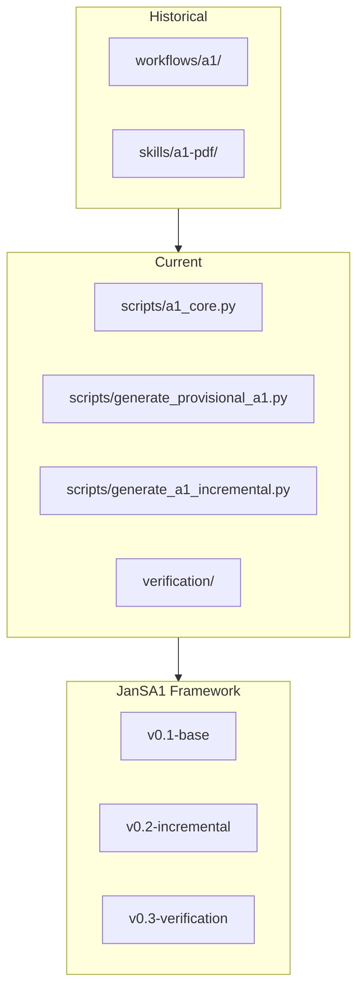

# JanSA1 Framework - Research Notes

## Research Date: 2026-09-16

## Similar Frameworks Found in Project

### 1. Workflows A1 (workflows/a1/)
```
workflows/a1/
├── README.md          # Original workflow documentation
└── .archive/         # Historical versions
```

### 2. Skills A1 (skills/a1-pdf-production/)
```
.agents/skills/a1-pdf-production/
├── SKILL.md          # Agent skill definition
├── agents/         # Agent-specific helpers
└── references/     # Reference materials
```

### 3. Historical Runtime Snapshots
```
runtime/s-*/
├── s-f54d4e6/       # Older version
├── s-4f5df59/       # Current snapshot
└── v12-review/       # Review version
```

### 4. Research Frameworks (readme-researches-frameworks.md)
- Documented LLM temperature optimization research
- Relevant for AI-assisted OCR and verification

## External Research Sources

### Czech A1 Certificate Standards
- **CSSZ** (Czech Social Security Administration)
  - Official form templates
  - Contact information
  - A1 certificate guidelines

### PDF Generation Best Practices
- **ReportLab** - Python PDF generation
- **pypdf** - PDF manipulation
- **Ghostscript** - PDF validation

### Verification Patterns
- **Dual Framework** - Compare two implementations
- **Schema Validation** - JSON/CSV/PDF schema
- **Hash Comparison** - Deterministic output

## Framework Evolution



## Version History in Project

| Version | Source | Date | Files |
|---------|--------|------|-------|
| Original | workflows/a1/ | 2026-08 | README, scripts |
| Skill | skills/a1-pdf/ | 2026-08 | SKILL.md, agents/ |
| Core | scripts/ | 2026-09 | a1_core.py, finalize_a1.py |
| Incremental | scripts/ | 2026-09 | generate_a1_incremental.py |
| Verification | verification/ | 2026-09 | dual_framework.py, etc. |

## Best Practices Identified

1. **Prefix Convention** - Prevents naming conflicts
   - `gen_` for generators
   - `chk_` for checkers
   - `cfg_` for configs

2. **Version Isolation** - Each version in separate folder
   - v0.1-base/
   - v0.2-incremental/
   - v0.3-verification/

3. **Symlink for Current** - Always points to latest
   - current/ → ../v0.3-verification/

4. **Verification Mandatory** - Every output verified
   - Schema validation
   - Hardcode check
   - Dual framework comparison

## GitHub Research Terms

Search for similar solutions:
```
site:github.com "a1 certificate" pdf
site:github.com "czech" "social security" certificate
site:github.com "reportlab" "pdf generation"
site:github.com "pypdf" "certificate generator"
```

## Related Documentation

- docs/architecture/ARCHITECTURE.md - Full architecture
- docs/architecture/A1_FRAMEWORKS.md - Framework comparison
- docs/architecture/verification-framework.md - Verification guide
- docs/architecture/langgraph-integration.md - Research orchestration

## TODO

- [ ] Search GitHub for similar A1 certificate generators
- [ ] Research PDF form generation libraries
- [ ] Compare with commercial solutions
- [ ] Document external API integrations
