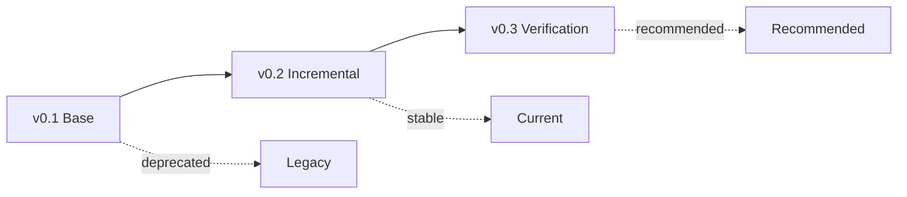

# JanSA1 Framework - Version History

## Historical Versions (i prefix)

These versions were extracted from existing project structure.

### i0.1 - Workflow A1
**Source:** `workflows/a1/`
**Date:** 2026-08

Original semi-manual workflow:
- Scan Upload → OCR → Transcription → PDF Generation → Visual QA
- See: `i0.1-workflow/README.md`

### i0.2 - Agent Skill A1
**Source:** `.agents/skills/a1-pdf-production/`
**Date:** 2026-08

Agent-facing skill documentation:
- Template cleaning, field placement, cohort generation
- See: `i0.2-skill/README.md`

### i0.3 - Core Scripts
**Source:** `scripts/`
**Date:** 2026-08 to 2026-09

Core Python scripts evolved:
- a1_core.py, finalize_a1.py, a1_quality_gate.py
- See: `i0.3-scripts/README.md`

### i0.4 - Portal Core
**Source:** `portal/release1a/`
**Date:** 2026-08 to 2026-09

Portal integration:
- a1_drafts.py, a1_exports.py, a1_prepare_draft.py
- See: `i0.4-core/README.md`

---

## Versioned Releases (v prefix)

### v0.3 - Verification Framework
**Date:** 2026-09-16
**Status:** Active (Recommended)

### Files
```
v0.3-verification/
├── chk_dual_framework.py     # Compare two framework outputs
├── chk_hardcode.py          # Verify no hardcoded values
├── chk_schema.py            # PDF/JSON/CSV schema validation  
├── chk_web_search.py        # External solution verification
└── doc_verification.md      # Verification documentation
```

### Changes from v0.2
- Added dual framework verification (hash comparison)
- Added hardcode checker
- Added schema validator
- Added web search verification

### Verification Results (Last: zimnuchov-igor-alexandrovic)
- Schema: ✓ 3 pages, not encrypted, N650 markers
- Hardcode: ✓ 11 values from input, 0 hardcoded
- Dual Framework: PARTIAL (needs second framework)

---

## v0.2 - Incremental Generation
**Date:** 2026-09-16
**Status:** Stable

### Files
```
v0.2-incremental/
├── gen_incremental.py        # Incremental generator
├── cfg_a1_generation.yaml   # YAML configuration
├── doc_incremental.md       # Documentation
└── src_processing.py        # Core processing logic
```

### Key Features
- Generates only missing PDFs
- Uses core logic: `display_row()` → `row_to_form()` → `build_form_data()`
- YAML-driven configuration
- Dashboard-ready

### Changes from v0.1
- Changed from batch to incremental
- Added YAML configuration
- Optimized for dashboard integration
- No lock conflicts

---

## v0.1 - Base Generation (Original)
**Date:** 2026-08
**Status:** Legacy

### Files
```
v0.1-base/
├── gen_provisional.py        # Original batch generator
├── fin_a1.py                # CSV processing
├── a1_core.py              # PDF rendering
├── qa_gate.py              # Quality gate
└── doc_original.md        # Original documentation
```

### Key Features
- Batch generation of all workers
- Full validation before generation
- Audit trail
- Lock-based publishing

### Known Limitations
- Generates all workers even if already exist
- No incremental update capability
- Lock conflicts with parallel runs

---

## Migration Path



## Git History Mapping

| Version | Git Commit | Files |
|---------|------------|-------|
| v0.1 | a48a1e8 | a1_core.py, finalize_a1.py |
| v0.2 | b24133f | generate_a1_incremental.py |
| v0.3 | 64e3191 | verification/*.py |

## Research Sources

For each version, verify against:

1. **Official Sources**
   - CSSZ.cz (Czech Social Security)
   - EU A1 regulations
   - Czech form standards

2. **Existing Implementations**
   - GitHub: Search "a1 certificate pdf generator"
   - PyPI: a1, czech, certificate packages
   - Stack Overflow: A1 form generation

3. **Validation**
   - Schema validation against official template
   - Visual comparison with real forms
   - Cross-framework equivalence check

## Rollback

If issues found in current version:
1. Revert to previous stable version
2. Re-run generation for affected workers
3. Compare outputs
4. Document discrepancy

Current stable: v0.2
Recommended: v0.3 (with verification)
