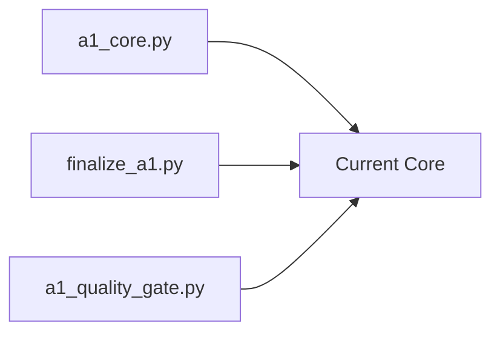

# Historical: Core Scripts (i0.3)

**Status:** Legacy
**Source:** `scripts/`
**Date:** 2026-08 to 2026-09

## Origin
```
scripts/
├── a1_core.py              # Original PDF rendering
├── finalize_a1.py         # CSV processing
├── generate_provisional_a1.py  # Original batch generator
├── a1_quality_gate.py    # QA pipeline
├── a1_audit.py           # Audit trail
├── a1_paths.py           # Path validation
├── a1_private.py         # Private path helpers
└── pdf_named_fields.py   # Placeholder framework
```

## Key Files

| File | Purpose | Current Status |
|------|---------|----------------|
| `a1_core.py` | PDF rendering | Active (v0.4) |
| `finalize_a1.py` | CSV → form | Active |
| `generate_provisional_a1.py` | Batch gen | Legacy |
| `a1_quality_gate.py` | QA | Active |
| `a1_audit.py` | Audit | Active |
| `a1_paths.py` | Paths | Active |
| `pdf_named_fields.py` | Placeholder | Alternative |

## Evolution



## Migrated To

- v0.2-incremental (generate_a1_incremental.py)
- v0.3-verification (verification/*.py)

## Notes

Core scripts evolved into:
1. Original batch generation
2. Quality gate additions
3. Incremental generation
4. Verification framework
