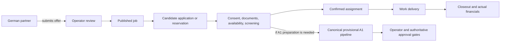

# Product Requirements Document — Czech-to-Germany Recruitment Operations Platform

**Status:** discovery draft 0.2 — full platform designed, Jan Release 1A first
**Date:** 2026-08-11
**Owner:** operator/product owner
**Scope:** product direction and acceptance boundaries; not authorization to deploy or process production PII

## 1. Product vision

Create a multilingual recruitment and operations platform that connects Czech
workers with German job opportunities while giving the Czech operator and German
partner companies one controlled workflow for jobs, applications, reservations,
availability, documents, assignments, communication, history, and financial
planning.

The existing scan-to-employee and employee-to-A1 workflows are internal
capabilities to integrate behind explicit approval gates. They are not yet a
general-purpose web backend and generated provisional A1 files are not issued
certificates.

## 2. Evidence and current baseline

This PRD incorporates the accepted
[planning review](docs/research/2026-08-12-plan-review-and-reorganization-report.md)
and historical research inputs. Stable current facts are:

- The active A1 path is reviewed inputs → institution profile →
  `generate_provisional_a1.py` → `finalize_a1.py` → `a1_core.py` → canonical
  background/layout → staged provisional package.
- The current cohort contract is exactly 11 unique people, 11 three-page PDFs,
  and 33 hash-bound previews. These artifacts remain operator-review material.
- The repository is in an unpublished transition. Plan L owns the documentation
  checkpoint and Plan Q owns reference/privacy and history-remediation procedure;
  volatile worktree counts are evidence snapshots, not product requirements.
- Earlier broad research plans are reviewed/historical inputs. Current discovery
  and design ownership is split across the active and planned plans in
  [`plans/INDEX.md`](plans/INDEX.md).
- Local RapidOCR is the preferred OCR direction. External model processing is an
  optional advisory fallback and must comply with repository privacy and
  verified-free-only rules.
- n8n Community is a plausible automation component for feed/social workflows,
  but it is not the product's authorization or audit system. Native audit-log
  streaming is an Enterprise feature.

## 3. Users and outcomes

### Candidate / worker

Browse and filter jobs, request contact or apply/reserve, provide contact and
availability data, upload OP/ZP securely, add notes, understand consent and
retention, and view application/assignment history.

### Czech operator

Manage jobs, candidates, German partners, applications, reservations, capacity,
documents, assignments, communication, status history, and planned-versus-actual
financials. See who accessed or changed sensitive records.

### German partner company

Create and maintain its own offers, capacity, dates, location, compensation and
requirements; see only authorized candidates and assignments; update fulfillment;
and access its own history.

### Administrator / data-protection role

Manage users and permissions, retention, exports/deletion, consent/legal-basis
records, security events, and auditable access without gaining unnecessary access
to identity documents.

## 4. Delivery scope

### Release 1A — first usable increment

- Private Pavel/Jan portal with organizations, memberships, MFA, and audit.
- Worker records with employee/self-employed activity profiles and provenance.
- Protected document upload, local OCR proposals, and human confirmation.
- Workplaces, effective-dated assignments, current/upcoming/history views, and
  overlap warnings.
- A1 case preparation, deterministic generation/QA, approval, and separate
  recording of official authority responses.

Release 1A implementation readiness is the M1A scaffolding gate. Broader N/O work,
Plan P, ADR-003, and later-module design continue in M1B and do not delay 1A.

Before scaffolding, the Release 1A catalog must freeze the bounded roles,
permissions, fields, reports, field necessity, authoritative sources, data states,
state transitions, audit events, and acceptance mappings needed by Jan's workflow.

### Full-platform target after Release 1A

### Public recruitment site

- Czech-first, German-ready job catalogue with search and filters.
- Job detail pages with structured metadata, capacity and availability status.
- Contact-request and application/reservation flows with confirmation.
- Accessible mobile-first experience and basic SEO/structured data.

### Candidate workspace

- Account or secure magic-link access.
- Contact details, availability, preferences, notes and status timeline.
- Secure OP/ZP upload with purpose, consent/legal basis, retention deadline and
  replacement/deletion controls.
- Application, reservation and assignment history.

### Operator dashboard

- CRUD and lifecycle management for jobs, candidates, partners, applications,
  reservations and assignments.
- Capacity and conflict checks; searchable immutable status history.
- Role-based document access and an access/change audit trail.
- Planned versus actual revenue/cost fields, cash-flow view and export.
- Manual review queue for OCR and A1 preparation.

### German partner portal

- Tenant-scoped job creation/editing and fulfillment status.
- Capacity, dates, location, pay, requirements and notes.
- Permission-scoped candidate/assignment views; no unrestricted document access.

### Integrations

- Import/consume free or contracted job feeds only after source terms are verified.
- Supported Meta Page/Instagram professional-account publishing through approved
  Graph API permissions; no browser automation.
- Notifications through a provider selected during architecture discovery.
- Internal handoff to the canonical A1 pipeline; operator approval remains
  mandatory before any final/issued state.

## 5. Explicitly outside Release 1A

- Automatic legal eligibility decisions or automatic issuance of A1 certificates.
- Copying issuance data between employees or treating placeholders as official.
- Unreviewed OCR writes to authoritative identity data.
- Scraping sources whose terms or permission are unclear.
- Browser-bot posting to Facebook/Instagram.
- Payroll activation, general accounting, electronic signatures, native mobile
  apps, and a marketplace for unrelated agencies. Czech/German payroll is designed
  now but activated later and independently after specialist certification;
  finance remains an operational subledger integrated with formal accounting.
- Paid AI APIs, paid fallbacks, or changes to the host LiteLLM gateway.

## 6. Core workflow and state model

Minimum state histories must be append-only events even when current state is
stored separately. State transitions need actor, timestamp, previous/new value,
reason, and correlation ID.

Every imported, OCR-derived, or human-reviewed field uses one explicit quality
state: `missing`, `proposed`, `confirmed`, `conflict`, or `superseded`. A proposal
never overwrites a confirmed value; conflicts require an attributable human
resolution and superseded values retain provenance.

## 7. Conceptual data model

- `User`, `Role`, `Organization`, `Membership`
- `Candidate`, `CandidateContact`, `Availability`, `Preference`
- `Document`, `DocumentVersion`, `ConsentOrLegalBasis`, `RetentionAction`
- `PartnerCompany`, `Job`, `JobCapacity`, `JobPublication`
- `Application`, `Reservation`, `Assignment`, `StatusEvent`, `Note`
- `BudgetPlan`, `RevenueItem`, `CostItem`, `PaymentEvent`
- `Message`, `Notification`, `IntegrationRun`
- `AuditEvent`, `DataAccessEvent`, `ExportOrDeletionRequest`
- `A1Case`, `A1Artifact`, `ApprovalEvent` (references/hashes, not copied form data)

Final fields, relations, and tenancy constraints are an architecture deliverable,
not settled by this draft.

## 8. Security, privacy, and compliance requirements

- EU-hosted production data by default; verify every processor and transfer.
- Encrypt transport, databases, and object storage; if backups are separately
  authorized, encrypt them too. Keep secrets outside source control and rotate them.
- Least-privilege RBAC plus organization/record scoping and explicit document
  access. German partners must never see unrelated candidates.
- Malware/type/size validation, quarantine, private object storage, short-lived
  signed URLs, and no public document URLs.
- Record purpose and lawful basis, provide notices in relevant languages, enforce
  retention and deletion, and support data-subject requests.
- Log authentication, authorization failures, document access, exports, changes,
  approvals and integration actions without logging document contents or secrets.
- External AI gets only minimal redacted crops when permitted; record provider,
  model, purpose and date; output remains untrusted until deterministic and human
  review.
- Obtain Czech/German legal review before production for employment/recruitment,
  identity-document handling, retention, cross-border processing, and financial
  records.

## 9. Non-functional requirements

- Czech and German localization from the data model onward; no text embedded only
  in templates.
- Responsive WCAG-oriented UI, keyboard operability and clear error recovery.
- Idempotent integrations and background jobs, retry/dead-letter handling, health
  monitoring and correlation IDs.
- Controlled Jan pilot: the owner may explicitly accept the documented no-backup
  durability risk; no agent silently enables or creates ad-hoc backups.
- Later production/public release: record an explicit durability decision, RPO/RTO,
  and supporting recovery evidence before launch. Backups are enabled only by a
  separate authorized design and must then have a tested restore procedure.
- Separate development/staging/production environments and synthetic test data.
- Exportable operational data and storage abstraction to limit vendor lock-in.
- Performance targets, availability SLOs, retention periods and scale assumptions
  must be set after baseline traffic and user-volume discovery.
- Every schema migration has a synthetic dry run, compatibility/rollback plan,
  reconciliation report, and explicit handling of interrupted or concurrent work.
- Retention design includes a deletion graph across source documents, proposals,
  authoritative revisions, derived previews/artifacts, exports, and minimal audit
  tombstones.
- Czech/German localization and accessibility form a testable contract: keyboard
  operation, visible focus, 200% zoom, 320px reflow, clear error recovery, and
  status meaning that does not depend on color.
- Every release defines incident response, deployment rollback, data-migration
  rollback limits, responsible owner, and evidence needed to resume safely.

## 10. MVP success measures

- A candidate can find and submit/reserve a suitable job from mobile without
  operator re-entry of basic data.
- An operator can trace every job from partner submission through assignment and
  planned/actual financial closeout.
- A partner can manage only its own jobs and authorized fulfillment records.
- Every sensitive document access and material status change is attributable.
- No authoritative employee/A1 value is changed solely by OCR or an external model.
- Feed and social runs are idempotent, attributable, and recoverable.
- Acceptance scenarios trace to roles, requirements, audit events, and automated or
  human tests; no Release 1A requirement is orphaned.
- A permission test matrix, retention/deletion test, incident procedure, and the
  durability evidence required for that release stage pass before launch.

## 11. Open product decisions

1. Commercial model after the confirmed private Jan-first increment.
2. Whether MVP consumes BA/EURES/direct feeds, publishes to external portals, or
   starts with operator/partner-authored jobs only.
3. Candidate login method and whether anonymous contact requests are retained.
4. Exact reservation semantics: soft interest, capacity hold, or binding booking.
5. Financial depth required in MVP and accounting-system integration boundaries.
6. Which OP/ZP fields are genuinely required and their legal retention periods.
7. Partner visibility into candidate profiles and documents.
8. Hosting, support, user volumes, launch countries, languages and budget.
9. Whether n8n is retained for orchestration after architecture scoring.
10. Legal review outcomes and the controller/processor allocation.
11. Specialist-certified Czech and German payroll rule sources, interfaces, and
    jurisdiction activation order.

## 12. Definition of ready for implementation

Release 1A implementation starts when roadmap M1A passes: Plan L's operating model,
a minimal Plan M shell, Plans E/F/H Release 1A outputs, the Release 1A slices of
Plans N/O, ADR-001/002, threat model, decision register, acceptance traceability,
synthetic security/data-flow tests, and an implementation-ready backlog. Plan P,
ADR-003, broader platform design, and open later-release business questions do not
block synthetic Release 1A work. New real-data portal use remains separately gated
by [`docs/security/real-data-rules.md`](docs/security/real-data-rules.md).
