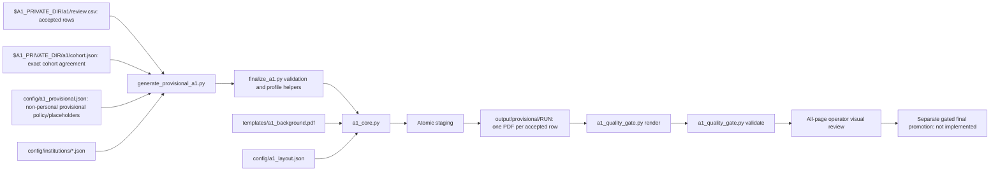

# Employees to A1 Form — Canonical Operator Workflow

## Purpose and release boundary

This workflow creates static three-page Czech A1 **client-confirmation copies**
from reviewed employee data. It is for an authorized operator. It does not issue
an A1 certificate and cannot promote provisional data without authoritative OSSZ
evidence and `validated_by_user=1`.

The cohort must agree exactly across the protected review CSV, normalized identity
source and cohort maps. Directory counts and historical batch sizes never authorize
new records. Policy defaults cannot override accepted evidence. The dated
2026-09-06 investigation found 25/25 rows blocked; this is historical evidence,
not a new inspection of current private data. Section 4 columns already exist;
missing authoritative values and approvals remain separate from schema presence.

Jan confirms factual information in the [operator workflow contract](docs/architecture/operator-a1-workflow.md).
The technical commands below are for the administrator. Application preparation and
an issued A1 are separate workflows; nobody should invent official certificate fields.

## Canonical pipeline



Legacy generators, coordinate files and alternate templates are not production
fallbacks. Never copy fields from one generated PDF into another.

## Prerequisites

- Python 3.13 environment with [requirements.txt](requirements.txt).
- Ghostscript for the additional PDF parser gate (the report records when absent).
- A Czech-capable TTF available to the renderer.
- Private reviewed CSV and access to the authorized source scans.
- Institution profiles with complete verification, official source URL and date.
- `A1_PRIVATE_DIR` set to the repository root. No tracked fallback is permitted.
- Administrator-provisioned `a1/operator.json` with an opaque `organization_id`
  (letters, digits, `_` or `-`, at most 64 characters). No personal values belong in
  this configuration. The authenticated local actor is recorded as the effective
  OS UID. Run under the authorized operator account; Jan need not edit configuration.
- RapidOCR uses pinned local ONNX models; Tesseract is not required.

Suggested local setup after reviewing package sources:

```bash
python3 -m venv venv
venv/bin/python -m pip install -r requirements.txt
venv/bin/python -m pytest -q
```

## Generate the provisional package

First inspect the CLI without mutation:

```bash
venv/bin/python scripts/generate_provisional_a1.py --help
```

After authoritative inputs pass readiness, choose a new package destination:

```bash
export A1_PRIVATE_DIR="$(git rev-parse --show-toplevel)"
A1_PACKAGE_REF="$(venv/bin/python -c 'import uuid; print(uuid.uuid4())')"
A1_PACKAGE="$A1_PRIVATE_DIR/output/provisional/$A1_PACKAGE_REF"
venv/bin/python scripts/generate_provisional_a1.py \
  --review $A1_PRIVATE_DIR/a1/review.csv \
  --cohort $A1_PRIVATE_DIR/a1/cohort.json \
  --profiles config/institutions \
  --config config/a1_provisional.json \
  --output "$A1_PACKAGE"
```

The generator writes one PDF per accepted row, `generation_manifest.json`,
`verification_table.csv`, and `CLIENT_CONFIRMATION_CHECKLIST.md`. Existing output
packages are rejected and preserved. Without `--output`, generation chooses a new
UUID directory under the protected provisional tree. Candidate generation behaves
likewise under `output/candidate/`. No backup-and-replace operation is performed.

Each operation has one full UUID in its manifest, append-only audit events and
`a1/receipts/<UUID>.json`. Missing context or an unavailable audit log blocks processing.
Receipts and artifacts are 0600, private directories 0700. Audit events contain no
employee values; readiness reports use row indices and field names.

## Render and deterministically validate

Always render previews from the just-generated PDFs:

```bash
venv/bin/python scripts/a1_quality_gate.py render \
  --pdf-dir "$A1_PACKAGE" \
  --preview-dir "$A1_PACKAGE-previews" \
  --contact-dir "$A1_PACKAGE-contacts" \
  --dpi 300

venv/bin/python scripts/a1_quality_gate.py validate \
  --pdf-dir "$A1_PACKAGE" \
  --preview-dir "$A1_PACKAGE-previews" \
  --config config/a1_provisional.json \
  --review $A1_PRIVATE_DIR/a1/review.csv \
  --cohort $A1_PRIVATE_DIR/a1/cohort.json \
  --background templates/a1_background.pdf \
  --layout config/a1_layout.json \
  --report "$A1_PACKAGE-qa-report.json" \
  --manifest "$A1_PACKAGE-qa-manifest.json"
```

The fail-closed gate checks cohort and preview counts, three pages, static PDFs,
required identity/address/activity text, unique IDs, cross-person identity
leakage, forbidden legacy text, template damage, hashes, and Ghostscript parsing.
CLI validation also requires a completed generation receipt and matching terminal
audit event. These and the generation manifest are bound into the QA manifest.
Rendering a manifestless legacy PDF is diagnostic only; validation cannot accept it.
Deterministic success does not replace all-page visual review.

## Visual review and final readiness

Inspect all three contact sheets and individual previews locally. Record a visual
pass only against an unchanged deterministic PASS manifest:

```bash
venv/bin/python scripts/a1_quality_gate.py record-review \
  --manifest "$A1_PACKAGE-qa-manifest.json" \
  --contact-dir "$A1_PACKAGE-contacts" \
  --output "$A1_PACKAGE-visual-review.json" \
  --reviewer OPERATOR_ID \
  --note "All pages reviewed against source data"
```

Before final generation, inspect blockers:

```bash
venv/bin/python scripts/finalize_a1.py readiness \
  --review $A1_PRIVATE_DIR/a1/review.csv
```

Final promotion is allowed only when every row has authoritative activity,
certificate and signatory sources; certificate review and PDF approval are YES;
`validated_by_user=1`; and visual QA is current. Every protected cohort addition
must enter the reviewed authoritative input before it can use the final path.

## Field policy

- Preserve scan-backed operator corrections and Czech/Slovak diacritics.
- Use normal display casing; preserve codes such as CZ, DE, OSSZ and ÚSSZ.
- Posted employees select 3.1/4.1.1; multi-state employees select 3.2/4.1.1;
  self-employed multi-state selects 3.4/4.1.2. Never substitute section 3.3 for employees.
- The requested employee-copy presentation leaves Section 5 values and 5.3 empty;
  this does not mean Section 5 is legally inapplicable to employees.
- Preserve authoritative reviewed IDs, dates and activity territory unchanged.
  Policy defaults (including DE) and historical cohort placeholders cannot override them.
- Generate candidate/provisional copies only after canonical source and approval
  validation. `finalize_a1.py generate` defaults to a new `output/candidate/<UUID>`; reserved final
  directories remain blocked pending receipt-bound promotion.
- An office director/contact is not automatically the certificate signatory.
- Do not add white masks, reconstruct template artwork during employee rendering,
  or patch individual PDFs.

## Inputs, outputs and provenance

| Path | Meaning |
|---|---|
| `$A1_PRIVATE_DIR/a1/review.csv` | Private scan-reviewed identities and operator decisions |
| `$A1_PRIVATE_DIR/a1/cohort.json` | Protected exact cohort and authoritative issuance values |
| `config/a1_provisional.json` | Non-personal provisional dates/IDs/activity policy and placeholders; never identities |
| `config/institutions/` | Source-dated OSSZ profiles and provisional office contacts |
| `config/institution.json` | Legacy/default-only finalize helper input; never substitutes for the reviewed row's active `config/institutions/<profile>.json` profile |
| `$A1_PRIVATE_DIR/a1/employees_normalized.json` | Private accepted identity reference; mismatches require explicit reconciliation |
| `scripts/generate_provisional_a1.py` | Canonical provisional entry point and atomic publisher |
| `scripts/finalize_a1.py` | Review validation, readiness, profile and finalization helpers |
| `scripts/a1_core.py` | Static overlay renderer and form validation |
| `templates/a1_background.pdf` | Canonical three-page background |
| `config/a1_layout.json` | Active fields and checkbox geometry |
| `scripts/a1_quality_gate.py` | Fresh rendering, deterministic QA and review binding |
| `output/provisional/` | Non-final client/operator confirmation package |
| `output/provisional-previews/` | PII-bearing fresh preview pages |
| `output/provisional-contact-sheets/` | PII-bearing visual-review sheets |
| `output/final/`, `output/pdf/` | Approval-only destinations; never provisional aliases |

## Failure and recovery

- Generation failure before publication removes staging and leaves the previous
  output intact.
- Existing destinations are rejected. A failed publish leaves no partial package.
- If storage also prevents rollback, `PUBLICATION_RECOVERY_REQUIRED` is recorded
  and success is refused. Administrators inspect the failed run; Jan does not
  choose a technical recovery strategy. Never reuse a package without a completed
  operation receipt and fresh QA.
- An incomplete audit line blocks new processing with `AUDIT_RECOVERY_REQUIRED`;
  preserve the log and investigate rather than silently discarding history.
- A failed quality gate removes/refuses a PASS manifest. Quarantine broken outputs
  with hashes; fix the responsible source/config/template/code layer and regenerate
  the whole affected set.
- Never accept filename equality or extracted-text presence alone as visual proof.

## Troubleshooting

| Problem | Response |
|---|---|
| Cohort mismatch | Reconcile the protected reviewed CSV and protected cohort additions; require exact unique IDs across review, normalized source and cohort maps |
| Missing institution profile | Add/verify the exact `institution_profile`; do not use another office |
| Stale preview/hash | Re-run `render`, then `validate`; do not copy old QA files |
| Template damage/clipping | Fix canonical background/layout/core and regenerate every affected PDF |
| Final readiness exits 1 | Supply authoritative evidence and operator approvals; do not weaken the gate |
| External vision unavailable | Continue deterministic/local review or defer; never select a paid fallback |

## Synthetic example

Tests use fictional employees and `example.invalid` institution sources. Extend
those fixtures for new logic; never copy a production row, scan, PDF, identifier or
address into a test.

Engineering update and remaining gates: [2026-09-06/07 delivery](docs/research/2026-09-06-a1-engineering-delivery.md).
