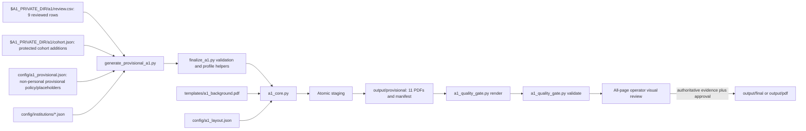

# Employees to A1 Form — Canonical Operator Workflow

## Purpose and release boundary

This workflow creates static three-page Czech A1 **client-confirmation copies**
from reviewed employee data. It is for an authorized operator. It does not issue
an A1 certificate and cannot promote provisional data without authoritative OSSZ
evidence and `validated_by_user=1`.

The intended cohort resolves only from `$A1_PRIVATE_DIR/a1/review.csv` plus
`$A1_PRIVATE_DIR/a1/cohort.json`, with 11 unique employee IDs required by the
current validation contract. `config/a1_provisional.json` contains non-personal
provisional policy/placeholders and is not an identity source. Current
regeneration is deliberately blocked because the private CSV predates the seven
explicit Section 4 employment columns now required by the renderer. Preserve the
existing provisional package, but do not describe it as reproducible until the
operator reviews and adds those columns.

## Canonical pipeline



Legacy generators, coordinate files and alternate templates are not production
fallbacks. Never copy fields from one generated PDF into another.

## Prerequisites

- Python 3.13 environment with [requirements.txt](requirements.txt).
- Ghostscript for the additional PDF parser gate (the report records when absent).
- A Czech-capable TTF available to the renderer.
- Private reviewed CSV and access to the authorized source scans.
- Institution profiles with official source URL and verification date.

Suggested local setup after reviewing package sources:

```bash
python3 -m venv venv
venv/bin/python -m pip install -r requirements.txt
venv/bin/python -m pytest -q
```

## Generate the provisional package

First inspect the CLI without mutation:

```bash
venv/bin/python scripts/generate_provisional_a1.py --help
```

After the private review input is migrated, generate through the canonical atomic
publisher:

```bash
venv/bin/python scripts/generate_provisional_a1.py \
  --review $A1_PRIVATE_DIR/a1/review.csv \
  --cohort $A1_PRIVATE_DIR/a1/cohort.json \
  --profiles config/institutions \
  --config config/a1_provisional.json \
  --output output/provisional
```

The generator writes 11 PDFs, `generation_manifest.json`,
`verification_table.csv`, and `CLIENT_CONFIRMATION_CHECKLIST.md`. If an output set
already exists, it is atomically renamed to a timestamped backup. Generation must
not modify the reviewed CSV, template, layout or profiles.

## Render and deterministically validate

Always render previews from the just-generated PDFs:

```bash
venv/bin/python scripts/a1_quality_gate.py render \
  --pdf-dir output/provisional \
  --preview-dir output/provisional-previews \
  --contact-dir output/provisional-contact-sheets \
  --dpi 300

venv/bin/python scripts/a1_quality_gate.py validate \
  --pdf-dir output/provisional \
  --preview-dir output/provisional-previews \
  --config config/a1_provisional.json \
  --review $A1_PRIVATE_DIR/a1/review.csv \
  --cohort $A1_PRIVATE_DIR/a1/cohort.json \
  --background templates/a1_background.pdf \
  --layout config/a1_layout.json \
  --report output/provisional/qa_report.json \
  --manifest output/provisional/qa_manifest.json
```

The fail-closed gate checks cohort and preview counts, three pages, static PDFs,
required identity/address/activity text, unique IDs, cross-person identity
leakage, forbidden legacy text, template damage, hashes, and Ghostscript parsing.
Deterministic success does not replace all-page visual review.

## Visual review and final readiness

Inspect all three contact sheets and individual previews locally. Record a visual
pass only against an unchanged deterministic PASS manifest:

```bash
venv/bin/python scripts/a1_quality_gate.py record-review \
  --manifest output/provisional/qa_manifest.json \
  --contact-dir output/provisional-contact-sheets \
  --output output/provisional/visual_review.json \
  --reviewer OPERATOR_ID \
  --note "All 33 pages reviewed against source data"
```

Before final generation, inspect blockers:

```bash
venv/bin/python scripts/finalize_a1.py readiness \
  --review $A1_PRIVATE_DIR/a1/review.csv
```

Final promotion is allowed only when every row has authoritative activity,
certificate and signatory sources; certificate review and PDF approval are YES;
`validated_by_user=1`; and visual QA is current. Every protected cohort addition
must enter the reviewed authoritative input before it can use the final path.

## Field policy

- Preserve scan-backed operator corrections and Czech/Slovak diacritics.
- Use normal display casing; preserve codes such as CZ, DE, OSSZ and ÚSSZ.
- The current provisional self-employed multi-state profile selects sections 3.4
  and 4.1.2 and uses activity location `DE, CZ`.
- Each provisional issue date is unique, Monday or Thursday, and 61–180 days before
  the reference date. Coverage ends one day before the first anniversary.
- Configured document IDs, dates, activity and office contact/signatory are
  placeholders until authoritative evidence exists.
- An office director/contact is not automatically the certificate signatory.
- Do not add white masks, reconstruct template artwork during employee rendering,
  or patch individual PDFs.

## Inputs, outputs and provenance

| Path | Meaning |
|---|---|
| `$A1_PRIVATE_DIR/a1/review.csv` | Private scan-reviewed identities and operator decisions |
| `$A1_PRIVATE_DIR/a1/cohort.json` | Protected current cohort additions and issuance values |
| `config/a1_provisional.json` | Non-personal provisional dates/IDs/activity policy and placeholders; never identities |
| `config/institutions/` | Source-dated OSSZ profiles and provisional office contacts |
| `config/institution.json` | Legacy/default-only finalize helper input; never substitutes for the reviewed row's active `config/institutions/<profile>.json` profile |
| `$A1_PRIVATE_DIR/a1/employees_normalized.json` | Private reconciliation reference; does not override later reviewed corrections |
| `scripts/generate_provisional_a1.py` | Canonical provisional entry point and atomic publisher |
| `scripts/finalize_a1.py` | Review validation, readiness, profile and finalization helpers |
| `scripts/a1_core.py` | Static overlay renderer and form validation |
| `templates/a1_background.pdf` | Canonical three-page background |
| `config/a1_layout.json` | Active fields and checkbox geometry |
| `scripts/a1_quality_gate.py` | Fresh rendering, deterministic QA and review binding |
| `output/provisional/` | Non-final client/operator confirmation package |
| `output/provisional-previews/` | PII-bearing fresh preview pages |
| `output/provisional-contact-sheets/` | PII-bearing visual-review sheets |
| `output/final/`, `output/pdf/` | Approval-only destinations; never provisional aliases |

## Failure and recovery

- Generation failure before publication removes staging and leaves the previous
  output intact.
- A successful replacement keeps the previous set as a timestamped ignored
  backup. Compare hashes before reusing any QA metadata.
- A failed quality gate removes/refuses a PASS manifest. Quarantine broken outputs
  with hashes; fix the responsible source/config/template/code layer and regenerate
  the whole affected set.
- Never accept filename equality or extracted-text presence alone as visual proof.

## Troubleshooting

| Problem | Response |
|---|---|
| Cohort mismatch | Reconcile the protected reviewed CSV and protected cohort additions; require the current validation contract of 11 unique IDs |
| Missing institution profile | Add/verify the exact `institution_profile`; do not use another office |
| Stale preview/hash | Re-run `render`, then `validate`; do not copy old QA files |
| Template damage/clipping | Fix canonical background/layout/core and regenerate every affected PDF |
| Final readiness exits 1 | Supply authoritative evidence and operator approvals; do not weaken the gate |
| External vision unavailable | Continue deterministic/local review or defer; never select a paid fallback |

## Synthetic example

Tests use fictional employees and `example.invalid` institution sources. Extend
those fixtures for new logic; never copy a production row, scan, PDF, identifier or
address into a test.
