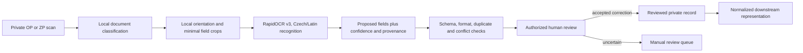
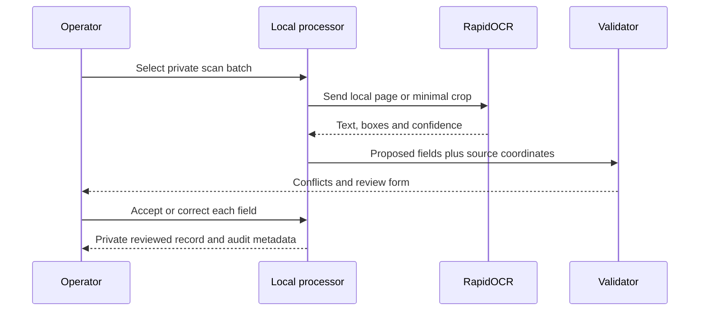

# Scan to Employees — Recovery and Production Contract

## Purpose and status

This workflow converts locally held OP/ZP scans into proposed normalized employee
records with field-level provenance and human review. It is intended for an
authorized operator handling identity documents.

**Current status: not executable from the active tree.** The former scan adapter
is absent from the active repository; there is no archived processor or executable
legacy OCR pivot plan to restore. Historical PaddleOCR material is reference-only.
The active OCR direction is a Release 1A portal interface whose role, field,
provenance, transaction, and review contracts must be specified by Plans N and O
and proved with synthetic fixtures before implementation.

## Intended data flow

## Inputs and outputs

Inputs belong under ignored/private storage, never documentation or fixtures:

- OP/ZP images or PDFs;
- operator batch metadata;
- `config/employee_schema.json` and normalization rules;
- explicit operator corrections.

The future processor should write to a protected private staging interface, not
directly to `$A1_PRIVATE_DIR/a1/employees_normalized.json`. Every proposed field needs:

- source document identifier/hash;
- page and crop/bounding box;
- OCR engine/model/version;
- raw OCR value and normalized proposal;
- confidence and validation results;
- operator decision, timestamp and correction reason.

## Required implementation before use

1. Select and prove a maintained local OCR adapter and Czech-capable recognition
   model through Plans E, N, and O; do not treat historical research versions as pins.
2. Record exact package/model versions and hashes selected by ADR-001 evidence.
3. Add 0/180-degree orientation handling. RapidOCR does not provide document
   unwarping; skew/perspective failures must go to manual review or a separately
   tested local preprocessing stage.
4. Map OP/ZP fields to `config/employee_schema.json` without inventing absent
   values.
5. Add duplicate detection, OP-versus-ZP conflict reporting and deterministic
   format/date/address validation.
6. Add a human-review UI or protected review file and an append-only audit record.
7. Add synthetic Czech/Slovak fixtures covering diacritics, glare, cropping,
   rotation, low confidence and conflicting documents.

There is deliberately no production scan command until the Release 1A interface,
adapter, and tests above exist.

## Optional external-model fallback

Local deterministic processing is first choice. An external model may receive
only the smallest necessary redacted crop when local OCR is insufficient and the
operator's legal/privacy basis permits it.

- Rediscover eligibility at execution time.
- OpenRouter model IDs must end exactly in `:free`, or use an explicitly free
  router whose resolved model is verified zero-cost.
- Require zero prompt and completion pricing plus image input.
- Never enable billing, buy credits, send a full OP/ZP scan, or fall back to a paid
  model after a 429/error.
- Log provider, resolved model, purpose, date, status and retry timing—but no key,
  authorization header, full request body, crop, or unrelated employee data.
- Treat returned values as proposals subject to the same deterministic and human
  review gates.

## Validation and eligibility for A1 use

A record becomes downstream-eligible only when required fields pass the employee
schema, document conflicts are resolved, provenance exists for every value, and an
authorized operator explicitly approves it. OCR confidence alone is never
approval. A later operator correction in `$A1_PRIVATE_DIR/a1/review.csv` outranks an
older normalized proposal when its provenance is recorded.

## Privacy and recovery

- Keep scans, crops, OCR results and reviewed records ignored and access-limited.
- Use synthetic records in tests, screenshots and examples.
- Do not log extracted identity values.
- Define retention before implementation; remove temporary crops promptly.
- On interruption, retain the immutable input hash and completed field decisions;
  resume into a new staging run rather than overwriting reviewed data.
- If output is corrupt, quarantine it locally with hashes and rerun from the source
  scans; never reconstruct identity data from generated A1 PDFs.

## Related files

| Path | Meaning |
|---|---|
| `config/employee_schema.json` | Current normalized-record validation reference |
| `config/address_enrichment.json` | Evidence-backed address reconciliation rules |
| `$A1_PRIVATE_DIR/a1/employees_normalized.json` | Private reconciliation reference; gitignored and privacy-sensitive |
| `$A1_PRIVATE_DIR/a1/review.csv` | Later operator-reviewed A1 input; ignored and authoritative for its nine rows |
| `plans/2026-08-12-plan-n-full-platform-role-and-data-discovery.md` | Release 1A OCR role, field, report, and necessity contract |
| `plans/2026-08-12-plan-o-database-and-transaction-architecture.md` | Release 1A OCR data, transaction, migration, and deletion design |
| `research/2026-08-11-ai-infra-library-findings.md` | Historical, time-sensitive research input only |

## Troubleshooting

| Problem | Response |
|---|---|
| `rapidocr` cannot be imported | Install pinned requirements in an isolated venv; do not switch silently to PaddleOCR |
| Czech diacritics are wrong | Confirm the Latin/Czech recognition model and route uncertain fields to review |
| Page is sideways | Apply tested 0/180 classification; 90/270 and perspective issues require preprocessing/manual review |
| OP and ZP disagree | Preserve both proposals and sources; require operator resolution |
| Free external model returns 429 | Record status/retry timing and defer or use another verified-free provider |
| No field provenance | Fail closed; do not publish a normalized/authoritative value |

## Synthetic example

A test fixture may use `employee_id=test-person-001`, fictional dates and
`TESTOVACÍ 1`. It must not resemble or derive from a real employee. Expected test
output includes source hash, field boxes, OCR proposals, validation findings and
operator decisions—never a real scan.
